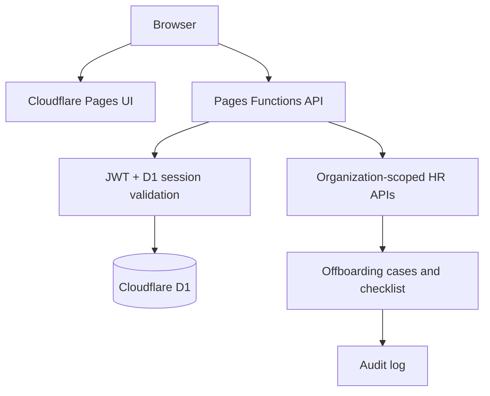

# JelHR System

A Cloudflare Pages + D1 HR workspace with separate administrator, employee and restricted demonstration access paths.

## Release status

The authentication and offboarding code paths have been added and the D1 schema has been applied to the connected database. **Authentication is not ready for real use until the production runtime secrets are configured, the initial owner is provisioned, and the smoke tests below pass.** Do not enter real employee, payroll, identity or health data until that sign-off is complete.

## Screenshot-inspired UI update

The sign-in and administrator dashboard use a light, rounded layout inspired by the supplied reference images. The original team illustration is generated for this project and embedded as a WebP data URL in `frontend/css/bolek.css`. Apple and Google sign-in are not offered; the existing email/password API remains the only sign-in method.

At common desktop and phone viewport sizes, the sign-in and dashboard fit within the viewport. On mobile, the dashboard uses three selectable panels to keep its links accessible without page scrolling. Extremely short viewports may scroll so the sign-in form remains accessible. Other workspace pages have not yet been converted to this layout and may scroll. The dashboard links to existing modules; it does not add a hiring, payroll, applications, calendar, or reviews backend. Directory, time, onboarding, security, and settings behavior remains at the prototype/demo level described below. See the readiness checklist before using real data.

## Access model

| Account type | Role | Access |
|---|---|---|
| Administrator | `owner` / `admin` | HR administration, employee directory and offboarding final approval |
| HR operations | `hr_manager` | HR workflows and offboarding case management; cannot perform final termination |
| Employee | `employee` | Employee workspace; no HR administration routes |
| Demo | `auditor` | Read-only access, only to synthetic data in a dedicated demo organization |

Demo accounts must be provisioned against a **separate organization populated only with synthetic data**. Do not grant an auditor/demo account access to a production organization containing real employee records.

## Authentication

- Email + password authentication; no Duo dependency.
- Passwords are salted and derived with PBKDF2-HMAC-SHA-256 (210,000 iterations) before storage.
- Eight-hour HS256 JWT in an HttpOnly, Secure, SameSite=Strict cookie.
- Server-side session record allows revocation; JWT validity alone is not sufficient.
- Login attempts are rate-limited by a hashed email/IP key.
- Protected API routes validate the JWT, session row, active user status, role and organization scope.
- Logout revokes the server-side session and clears the cookie.
- No password or signing key is stored in source control.

### Required production runtime secrets

Configure these as **Cloudflare Pages production secret environment variables** before enabling sign-in:

- `JELHR_JWT_SECRET`: at least 32 random bytes; use a cryptographically secure generator.
- `JELHR_ADMIN_EMAIL`: initial owner email.
- `JELHR_ADMIN_PASSWORD`: initial owner password (minimum 14 characters).
- `JELHR_BOOTSTRAP_TOKEN`: separate high-entropy one-time provisioning token.

The application currently uses Pages Function environment bindings. The Cloudflare Secrets Store in the other account is not automatically available to this Pages project; do not assume it is connected merely because a store exists. If central Secrets Store sourcing is required, connect a dedicated JelHR Worker/API backend in the relevant account and bind the store there. Do not reuse the Master AI Worker or its JWT signing key.

### Provision the first owner

After the runtime secrets are set and the D1 migration is applied, call the one-time endpoint with the bootstrap token:

```bash
curl -X POST https://jelhr-system.pages.dev/api/auth/bootstrap \
  -H "Authorization: Bearer $JELHR_BOOTSTRAP_TOKEN" \
  -H "Content-Type: application/json" \
  -d '{"confirmation":"PROVISION INITIAL ADMIN"}'
```

The endpoint refuses to run once an owner/admin exists. Remove the bootstrap token and the initial admin password secret after successful provisioning. The owner password is stored only as a PBKDF2-derived hash.

## Offboarding

The offboarding module provides:

1. Case initiation with employee, reason and last working day.
2. A generated 12-step checklist covering knowledge transfer, IT access, sessions and credentials, company assets, finance, exit interview, employee communications and compliance.
3. Task states: pending, in progress, completed, blocked or not applicable.
4. Evidence notes on checklist tasks.
5. Exit interview and final-pay status fields.
6. Tenant-scoped case and asset lookups.
7. Final closure restricted to owner/admin and blocked until every task is completed or explicitly marked not applicable.
8. On final closure, employee status becomes terminated, linked user status becomes disabled, and linked sessions are revoked.
9. Audit events are written for case initiation, task updates and case completion.

Important operational controls:
- IT access must be disabled at the approved effective time, not merely when the case is opened.
- The checklist records required work; integrations with identity providers, email, endpoint management, asset inventory and payroll are not yet connected. An HR/IT operator must complete those actions in the connected systems and record evidence.
- Final-pay status is a workflow marker, not a payroll calculation or payment instruction.
- Apply local labor law, privacy requirements, retention schedules and legal holds before deleting or archiving records.

## API routes

| Route | Method | Purpose |
|---|---|---|
| `/api/auth/login` | POST | Email/password login and JWT session |
| `/api/auth/me` | GET | Current authenticated identity |
| `/api/auth/logout` | POST | Revoke current session |
| `/api/auth/bootstrap` | POST | One-time initial owner setup; requires bootstrap bearer token |
| `/api/employees` | GET | Tenant-scoped employee lookup for HR |
| `/api/offboarding` | GET / POST | List and initiate offboarding cases |
| `/api/offboarding/:id` | GET / PATCH | Read case, update checklist/status and finalize |

## Current modules

| Module | Current behavior |
|---|---|
| Dashboard | Workforce overview |
| Employees | Existing prototype directory; real API integration still needs completion |
| Time tracking | Browser-local prototype |
| Onboarding | Browser-local checklist prototype |
| Offboarding | D1-backed case and task APIs |
| Security | Existing demo surface; full session administration UI still needs completion |
| Employee workspace | Authenticated employee landing page |
| Demo workspace | Sample-only read-only presentation; requires a separate demo tenant/account |
| API health | `GET /api/health` |

## Cloudflare deployment

- Pages project: `jelhr-system`
- Production URL: https://jelhr-system.pages.dev
- GitHub source: `DevJel/jelhr-system`, branch `main`
- Pages Functions: `functions/`
- D1 binding: `DB` → `jelhr-system-db`
- D1 migrations: `migrations/`

GitHub pushes to `main` trigger Pages deployments. Run `npm test` and verify production API routes after each deployment.

## Data model

D1 contains organization-scoped users, employees, time entries, onboarding tasks, sessions, audit logs, offboarding cases, offboarding tasks, asset records and authentication rate-limit/event tables.



## Run locally

```bash
npm install
npm run dev
```

Local Pages Functions require compatible D1 bindings and local runtime secrets. Never put real production credentials in `.dev.vars` committed to Git.

## Security and readiness checklist

- [ ] Set production `JELHR_JWT_SECRET`, `JELHR_ADMIN_EMAIL`, `JELHR_ADMIN_PASSWORD` and `JELHR_BOOTSTRAP_TOKEN` as secret bindings.
- [ ] Provision initial owner and remove bootstrap credentials.
- [ ] Provision a separate demo organization with synthetic records and auditor account.
- [ ] Provision employee users and map each user to exactly one employee record.
- [ ] Complete API-backed employee CRUD and enforce self-only employee reads.
- [ ] Connect IT identity, email, device, asset and finance systems for actual offboarding execution.
- [ ] Complete asset return UI, final-pay approvals and exit interview capture.
- [ ] Add CSRF protection for state-changing cookie-authenticated routes and validate Origin.
- [ ] Run automated auth, tenant-isolation, role, offboarding and session-revocation tests.
- [ ] Complete privacy, retention, backup/restore and security review.

Do not describe the application as production-ready until every required item above is verified.

## Project structure

```
frontend/                  Static responsive UI
  login.html               Unified sign-in
  employee.html            Employee workspace
  demo.html                Restricted demo presentation
  offboarding.html         HR offboarding workflow
  css/app.css              Shared design system
  js/nav.js                Authenticated navigation bootstrap
functions/api/auth/        Login, session, logout and bootstrap
functions/api/offboarding/ Tenant-scoped offboarding API
functions/api/employees/   HR employee lookup
functions/_shared/         JWT/session authorization and audit helpers
migrations/                D1 schema migrations
wrangler.toml              Pages output and D1 binding
```
