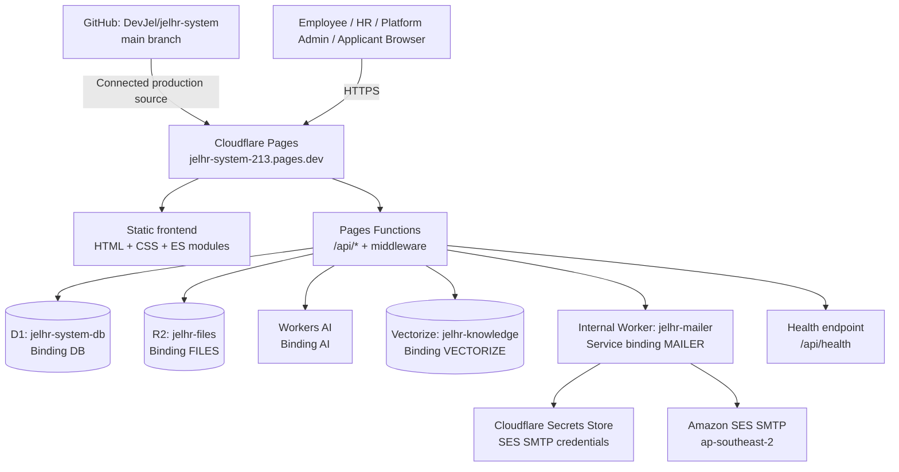
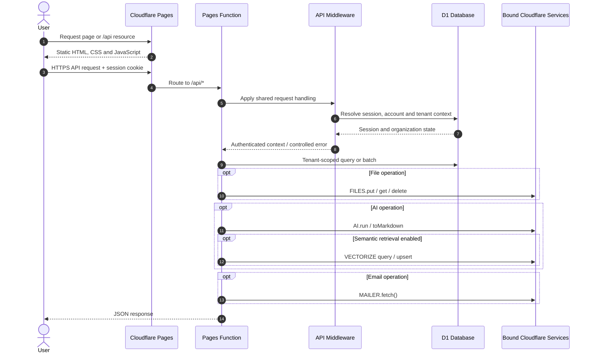
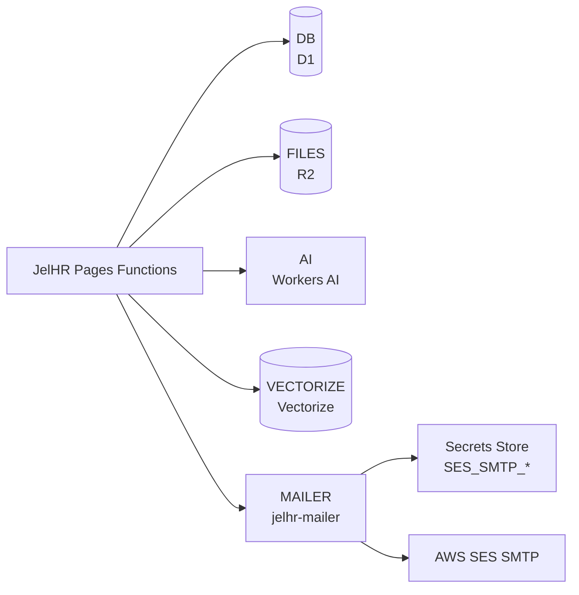
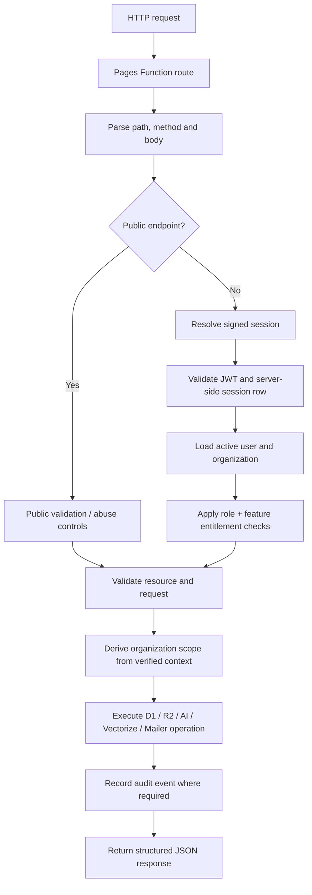
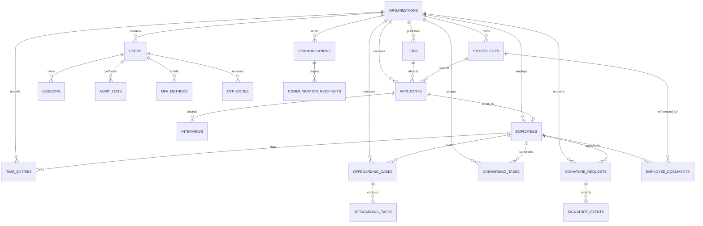
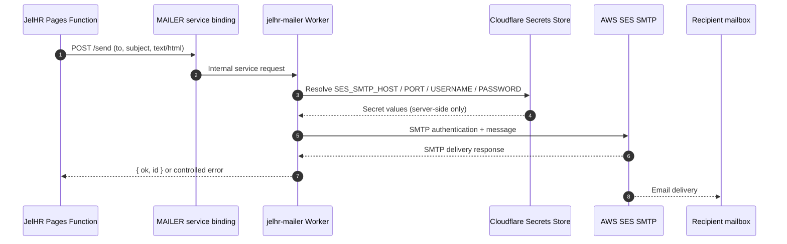
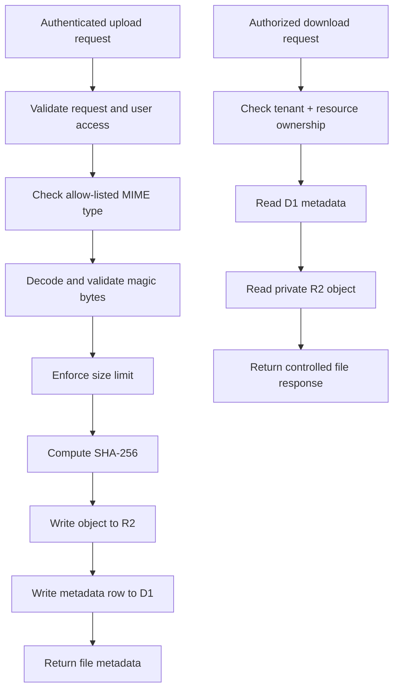

# JelHR System

**JelHR** is a multi-tenant Human Resources Information System (HRIS) designed to support the employee lifecycle: recruitment, applicant screening, hiring, onboarding, employee administration, time tracking, documents, communications, electronic signatures and offboarding.

The production deployment is hosted on **Cloudflare Pages in the Jelvan - Business - Operava account**. Its server-side API runs on Pages Functions, with Cloudflare D1 as the relational system of record, R2 for private file objects, Workers AI for assisted HR workflows, Vectorize for optional semantic retrieval, and an internal Worker service binding for AWS SES email delivery.

<p align="center">
  
</p>

<p align="center">
  
  
  
  
  
</p>
<p align="center">
  
  
  
  
  
  
</p>

> [!IMPORTANT]
> **Release boundary — v0.4 backend deployed; v0.4 frontend in draft PR #7.** Production remains on the previously deployed v0.3 browser interface. The new recruitment/careers, invitation, AI assistant, workspace settings, user access, employee paperwork, MFA/passkey and platform screens are being added in branch `v0.4-frontend`; they are not merged or deployed. The login backend now follows the organization MFA policy, and the UI supports email/TOTP/passkey challenge selection, but browser/device verification is still required. Platform administration was last observed as not initialized (`platformAdmin: false`), and real SES delivery and production Turnstile checks remain release gates. Keep the application on synthetic data until the [production go-live checklist](DEPLOYMENT.md#release-status-and-go-live-checklist) is complete.

---

## Contents

- [Product scope](#product-scope)
- [Technology stack](#technology-stack)
- [System architecture](#system-architecture)
- [Production deployment](#production-deployment)
- [Cloudflare bindings and resources](#cloudflare-bindings-and-resources)
- [Secrets and configuration](#secrets-and-configuration)
- [Application architecture](#application-architecture)
- [Database and data model](#database-and-data-model)
- [Authentication, authorization and tenant isolation](#authentication-authorization-and-tenant-isolation)
- [Email delivery architecture](#email-delivery-architecture)
- [AI and knowledge architecture](#ai-and-knowledge-architecture)
- [File and document architecture](#file-and-document-architecture)
- [API surface](#api-surface)
- [Repository structure](#repository-structure)
- [Local development and testing](#local-development-and-testing)
- [Deployment and migration workflow](#deployment-and-migration-workflow)
- [Security and operational practices](#security-and-operational-practices)
- [Response security headers](#response-security-headers)
- [Current release limitations](#current-release-limitations)
- [Related documentation](#related-documentation)

---

## Product scope

| Domain | Capabilities represented in the current codebase |
|---|---|
| **Organization administration** | Platform-level organization creation, owner/admin provisioning, organization status, feature entitlements and AI usage quotas. |
| **Recruitment** | Job postings, applicant records, recruitment stages, interview scheduling, applicant screening assistance and hire-to-employee conversion APIs. |
| **Public careers** | Organization-branded job listing and application endpoints, privacy acceptance, honeypot and rate-limit controls, optional Turnstile, résumé validation and confirmation email. |
| **People directory** | Employee profiles, departments, managers, employment status, employee-linked accounts and former employee contact preferences. |
| **Onboarding** | Standard and custom onboarding tasks, ownership, due dates and completion tracking. |
| **Time management** | Clock-in/clock-out entries, breaks, manager/HR review and approval state. |
| **Offboarding** | Case management, task checklist, approvals, exit interview, final-pay status, asset return and access termination. |
| **Documents and paperwork** | Résumés, employee documents, file metadata, upload validation and private file retrieval. |
| **Electronic signatures** | Templates, signer consent, typed/drawn signatures, document fingerprints, signing events, certificate evidence, decline and void flows. |
| **Communications** | Drafts, recipient selection, consent-aware applicant communications, batch sending, delivery status, retries and cancellation. |
| **Authentication and security** | Password authentication, secure sessions, session revocation, sign-in identifiers, MFA/TOTP, passkeys, email OTP, OIDC SSO and audit logs. |
| **AI assistant services** | HR drafting, rewriting, job descriptions, applicant screening assistance, document explanation, exit summaries and organization knowledge retrieval. |

AI output is advisory. It must be reviewed by an authorized human and must not autonomously reject applicants, make employment decisions, change employee status or send HR/legal communications without an explicit authorized action.

## Technology stack

### Frontend

| Technology | Use |
|---|---|
| HTML5 | Static multi-page application and semantic page structure. |
| CSS3 | Application design system, responsive layouts, components, state styling and reduced-motion support. |
| Vanilla JavaScript (ES modules) | API client, session-aware page behavior, navigation, dialogs, forms and feature modules. |
| Owned SVG icon sprite | Local interface icons and app icon assets. |
| WebP / SVG assets | Optimized illustrations, branding and screenshots. |
| Native browser APIs | Fetch, FormData, URL, DOM, and browser credential interfaces where supported. |

**No frontend framework is currently declared**: the application does not declare React, Vue, Angular, Svelte, Next.js or a bundler as a runtime dependency. The current UI is static HTML/CSS/JavaScript. The v0.4 frontend pages are still pending.

### Backend and runtime

| Technology | Use |
|---|---|
| Cloudflare Pages | Static hosting, production deployment and routing. |
| Cloudflare Pages Functions | Server-side API routes and middleware, running on the Workers runtime. |
| JavaScript ES modules | Backend route handlers and shared domain modules. |
| Cloudflare Workers runtime APIs | Request/Response, Fetch, Web Crypto, streams and runtime bindings. |
| Cloudflare D1 | SQLite-compatible relational database and transactional/batched SQL operations. |
| Cloudflare R2 | Private object storage for uploaded documents and résumés. |
| Cloudflare Workers AI | Model inference and document-to-Markdown conversion. |
| Cloudflare Vectorize | Optional semantic search index for organization-scoped knowledge retrieval. |
| Cloudflare Secrets Store | Centralized storage of shared SES SMTP credentials, consumed by the internal mailer Worker. |
| Cloudflare Worker service binding | Private Pages-to-mailer service communication without a public mailer endpoint. |
| Amazon Simple Email Service (SES) | Outbound application email through the existing AWS SES SMTP endpoint in `ap-southeast-2`. |

### Development, testing and tooling

| Technology | Use |
|---|---|
| Node.js 22.5+ | Local scripts and test runtime. |
| Node.js built-ins | `node:test`, assertions, filesystem utilities and `node:sqlite` in the offline D1 shim. |
| Wrangler CLI | Local Pages development, D1 migration operations and deployment commands. Invoked with `npx wrangler@latest`; Wrangler is not declared as a package dependency in the current `package.json`. |
| Python 3 | Image generation helper in `scripts/generate-images.py`. |
| GitHub | Source control and the connected production deployment source. |

### Dependency policy

The current `package.json` declares no `dependencies` or `devDependencies`. Application logic uses native browser APIs and Cloudflare/Node runtime APIs. Do not assume an npm framework, ORM, component library, CSS framework, bundler or test framework is installed. The automated tests use Node's built-in `node:test` runner.

---

## System architecture

### 1. High-level deployment topology

The following diagram describes the current production architecture. The Pages project serves the static frontend and routes API requests to Pages Functions. Functions use explicit Cloudflare bindings to reach the database, object storage, AI, vector index and internal mailer service.



### 2. Browser request and API lifecycle



### 3. End-to-end employee lifecycle

```mermaid
flowchart LR
    A["Publish job"] --> B["Receive application"]
    B --> C["Review / AI-assisted screening"]
    C --> D["Interview"]
    D --> E{"Hiring decision"}
    E -->|"Proceed"| F["Hire applicant"]
    E -->|"Decline / withdraw"| X["Close application"]
    F --> G["Create employee record"]
    G --> H["Invite account"]
    H --> I["Onboarding tasks"]
    I --> J["Active employee"]
    J --> K["Time, documents, communications"]
    K --> L["Offboarding case"]
    L --> M["Tasks, assets, exit interview"]
    M --> N["Approvals and signatures"]
    N --> O["Terminate access / revoke sessions"]
```



### 4. Main request trust boundaries

- **Public browser:** untrusted input. Client-side validation improves usability but is never the security boundary.
- **Pages Functions:** server-side validation, authorization, tenant scoping, workflow enforcement and audit recording.
- **D1:** authoritative relational records. Tenant identifiers are derived from the verified session and checked against the requested resource.
- **R2:** private file bytes. Object keys include the organization namespace; file metadata and access authorization are checked by the API.
- **AI provider:** receives only the context assembled by the server. AI output remains untrusted advisory content.
- **Mailer Worker:** internal service binding, not intended as a public HTTP endpoint. SMTP credentials are resolved server-side from Secrets Store.

---

## Production deployment

| Setting | Production value |
|---|---|
| Repository | [DevJel/jelhr-system](https://github.com/DevJel/jelhr-system) |
| Branch | `main` |
| Cloudflare account | Jelvan - Business - Operava |
| Pages project | `jelhr-system` |
| Production URL | [https://jelhr-system-213.pages.dev](https://jelhr-system-213.pages.dev) |
| Static output directory | `frontend/` |
| Functions directory | `functions/` |
| Build command | None currently configured |
| Wrangler configuration | `wrangler.toml` |
| Preview deployments | Disabled until isolated preview resources exist |
| Health endpoint | [https://jelhr-system-213.pages.dev/api/health](https://jelhr-system-213.pages.dev/api/health) |

Commits to the connected `main` branch trigger production deployments. Do not configure preview deployments to use production D1, R2 or Vectorize resources.

The former Projects - Works Pages project and its D1 database were preserved. They are not the active Operava Business production database. See [DEPLOYMENT.md](DEPLOYMENT.md) for the migration and preservation notes.

---

## Cloudflare bindings and resources

The production Pages Functions environment uses the following binding names. These names are part of the application contract; if a binding is renamed, update the code and Wrangler configuration together.

| Binding | Cloudflare type | Resource | Application responsibility |
|---|---|---|---|
| `DB` | D1 database binding | `jelhr-system-db` | Multi-tenant relational records, authentication state, workflows, audit logs, file metadata and AI conversations/knowledge records. |
| `FILES` | R2 bucket binding | `jelhr-files` | Résumés, employee documents and other private uploaded file objects. |
| `AI` | Workers AI binding | Workers AI | HR assistant inference, structured drafting/screening support and `toMarkdown` document conversion. |
| `VECTORIZE` | Vectorize binding | `jelhr-knowledge` | Optional semantic indexing/retrieval. The application also has organization-scoped keyword search in D1. |
| `MAILER` | Worker service binding | `jelhr-mailer` | Private Pages-to-Worker email handoff; the mailer sends through AWS SES SMTP. |

### D1 — relational system of record

- Database: `jelhr-system-db`
- Binding: `DB`
- Database ID: `65b599fb-e45d-4f92-8588-d353df0e1cb8`
- Migrations: `migrations/0001_init.sql` through `migrations/0004_recruitment_ai_auth.sql`
- Data access: prepared statements, bound parameters and D1 batch operations.
- Schema changes: additive migration files; apply migrations before deploying code that depends on them.

### R2 — document and object storage

- Bucket: `jelhr-files`
- Binding: `FILES`
- Object key pattern: `org/{organizationId}/{fileId}`
- The D1 `stored_files` row retains organization, content type, size, SHA-256 and storage metadata.
- Current upload validation checks declared content type, file magic bytes and size.
- With R2 bound, the application upload limit is 5 MiB. The D1 inline fallback is limited to 1.5 MiB.
- Supported file types are PDF, DOC/DOCX, PNG, JPEG, WebP and plain text, subject to route-specific allow-lists.

### Workers AI — inference and document conversion

- Binding: `AI`
- Provider selector: `AI_PROVIDER=workers-ai`
- Configured model: `@cf/meta/llama-3.3-70b-instruct-fp8-fast`
- The shared AI module also supports OpenAI-compatible APIs, Anthropic and a deterministic development-only mock provider.
- Workers AI `toMarkdown` is used when available for supported uploaded document conversion.
- AI responses are not authoritative employment decisions.

### Vectorize — optional semantic retrieval

- Index: `jelhr-knowledge`
- Binding: `VECTORIZE`
- Dimensions: `768`
- Metric: `cosine`
- The application code uses an organization ID namespace for vector retrieval when the binding is present.
- D1 keyword search remains available as the non-vector fallback. Do not assume Vectorize is populated merely because the binding is configured.

### Mailer service — internal email delivery

- Service binding: `MAILER`
- Worker service: `jelhr-mailer`
- Internal request: `POST /send`
- Sender: `noreply@operavaglobal.com`
- Provider: AWS SES SMTP in `ap-southeast-2`
- SMTP credentials are obtained from the shared Operava Cloudflare Secrets Store, not from source code or Wrangler variables.
- The Pages application sends email through `env.MAILER.fetch()`; Pages Functions do not receive SMTP credentials.

### Binding relationship



---

## Secrets and configuration

### Non-secret production variables

| Variable | Current value / purpose |
|---|---|
| `JELHR_ENV` | `production` |
| `AI_PROVIDER` | `workers-ai` |
| `AI_MODEL` | `@cf/meta/llama-3.3-70b-instruct-fp8-fast` |
| `EMAIL_FROM` | `noreply@operavaglobal.com` |

These values are represented in `wrangler.toml` and/or the Pages deployment configuration. Keep the deployment configuration and Wrangler file aligned.

### Encrypted Pages secrets

| Secret name | Purpose | Status |
|---|---|---|
| `JELHR_JWT_SECRET` | Session signing and OTP HMAC key material. | Configured |
| `JELHR_ENCRYPTION_KEY` | AES-GCM key material for encrypted SSO/TOTP values. | Configured |
| `JELHR_SUPERADMIN_EMAIL` | Platform super-admin identity. | Encrypted secret entry is present in Pages configuration; bootstrap is not yet confirmed. |
| `JELHR_SUPERADMIN_PASSWORD` | Platform super-admin password; minimum 16 characters. | Encrypted secret entry is present in Pages configuration; bootstrap is not yet confirmed. |
| `JELHR_SUPERADMIN_TOTP_SECRET` | Optional platform-admin TOTP factor. | Optional |

### Shared Cloudflare Secrets Store values

The internal `jelhr-mailer` Worker has all four SMTP credential references attached as `secrets_store_secret` bindings to the Operava Secrets Store:

- `SES_SMTP_HOST`
- `SES_SMTP_PORT`
- `SES_SMTP_USERNAME`
- `SES_SMTP_PASSWORD`

Cloudflare configuration confirms that the Worker references all four names above. The same store also lists `SES_SMTP_REGION`; it is not currently part of the Worker binding list. Secret values must never be printed in logs, committed to Git, added to `wrangler.toml`, copied into README files or exposed through the health endpoint.

### Optional feature secrets

| Variable | Used for |
|---|---|
| `AI_API_BASE`, `AI_API_KEY`, `AI_MODEL` | Optional OpenAI-compatible AI provider. |
| `ANTHROPIC_API_KEY` | Optional Anthropic provider. |
| `TURNSTILE_SITE_KEY`, `TURNSTILE_SECRET_KEY` | Optional Cloudflare Turnstile for public careers/application flows. |
| `JELHR_WEBAUTHN_RP_ID`, `JELHR_WEBAUTHN_ORIGINS` | WebAuthn/passkey relying-party configuration. |

Do not enable a feature simply because optional configuration names exist in code. Configure, test and document the feature first.

---

## Application architecture

### Frontend layers

| Layer | Files | Responsibility |
|---|---|---|
| Page documents | `frontend/*.html` | Static pages and semantic page structure. |
| Design system | `frontend/css/app.css` | Theme variables, layout, typography, controls, tables and responsive styles. |
| App bootstrap | `frontend/js/app.js` | Application initialization and shared page startup. |
| Navigation | `frontend/js/nav.js` | Navigation and application shell behavior. |
| Shared app behavior | `frontend/js/app.js`, `nav.js` and the page scripts | Shared page initialization, navigation and common client behavior. |
| Login | `frontend/js/login.js` | Existing sign-in interface. |
| Dashboard | `frontend/js/dashboard.js` | Dashboard behavior and summary rendering. |
| Page scripts | `frontend/js/*.js` | Login, dashboard, app bootstrap and navigation behavior. |
| Static response headers | `frontend/_headers` | Security headers for static Pages assets and documents. |
| Function response headers | `functions/_shared/http.js`, `functions/api/_middleware.js` | The same policy for API and Pages Function responses, including generated errors. |


The current repository tree is authoritative. The v0.4 backend endpoints do not imply that a matching v0.4 frontend screen already exists.

### Backend layers

| Layer | Location | Responsibility |
|---|---|---|
| API entry and routing | `functions/api/[[path]].js` | Catch-all route handling for API requests. |
| Shared middleware | `functions/api/_middleware.js` | Shared request processing and security behavior. |
| API route handlers | `functions/api/**` | Resource-specific request/response handling. |
| Authentication | `functions/_shared/auth.js`, `login.js`, `authpolicy.js` | Session resolution, role checks, sign-in policy and authorization. |
| Cryptography | `functions/_shared/crypto.js` | Password/session cryptographic helpers, hashes and encryption primitives. |
| Validation and HTTP | `functions/_shared/validate.js`, `http.js` | Input validation, structured responses and controlled errors. |
| Email | `functions/_shared/email.js`, `smtp.js`, `sigv4.js` | Email provider abstraction and SMTP-related support. Production Pages email uses the internal mailer service binding. |
| AI | `functions/_shared/ai.js`, `aicontext.js` | Provider selection, inference and tenant-aware prompt context. |
| Knowledge | `functions/_shared/knowledge.js` | Organization knowledge records and retrieval. |
| File storage | `functions/_shared/files.js` | Upload validation, R2/D1 storage and retrieval. |
| Recruitment | `functions/_shared/recruitment.js` | Recruitment domain helpers and applicant workflow behavior. |
| E-signature | `functions/_shared/esign.js`, `esign-templates.js` | Signature request and template workflows. |
| SSO / passkeys | `functions/_shared/oidc.js`, `webauthn.js` | OIDC and WebAuthn protocol helpers. |
| Feature entitlements | `functions/_shared/features.js` | Organization and per-user feature restrictions. |
| Platform administration | `functions/_shared/platform.js` | Platform-level administrative configuration and behavior. |

### API request processing



---

## Database and data model

D1 is the authoritative relational database. Schema changes are tracked through four ordered SQL migrations:

| Migration | Scope |
|---|---|
| `0001_init.sql` | Organizations, users, employees, time entries, onboarding tasks, sessions, audit logs and organization settings. |
| `0002_auth_offboarding.sql` | Password hardening fields, offboarding cases/tasks, employee assets, authentication rate limits and authentication events. |
| `0003_people_ops_esign.sql` | People operations extensions, offboarding workflow evidence, e-signature requests/events, applicants and communications. |
| `0004_recruitment_ai_auth.sql` | Recruitment jobs/interviews, applicant extensions, files, AI usage/conversations, organization knowledge, MFA, passkeys, OIDC SSO and invitation flows. |

### Core entity relationships



This is a conceptual overview of the schema; consult the migration SQL for exact columns, indexes, constraints and foreign keys.

### Tenant isolation rules

1. Resolve the user's session on the server.
2. Validate the session signature, expiry, revocation state and backing D1 session record.
3. Load the active user and active organization.
4. Derive `organization_id` from the verified server-side user context.
5. Scope reads, writes, files, AI context and knowledge retrieval to that organization.
6. Validate resource ownership before modifying or returning a record.
7. Record audit events for sensitive operations.
8. Never trust a tenant ID, role, employee ID or permission supplied only by the browser.

### Data preservation

The legacy Projects - Works Pages project and D1 database were preserved during migration. The original database was not deleted or repurposed. The read-only audit before migration found no organization, user, employee, applicant or operational rows in the legacy application's relevant tables; the Operava Business database was provisioned with the v0.4 schema. Do not remove the legacy resources until the new environment has been accepted and a separate retention decision is made.

---

## Authentication, authorization and tenant isolation

### Session flow

- Session cookie name: `jelhr_session`.
- Cookie attributes: `HttpOnly`, `Secure`, `SameSite=Strict`, `Path=/`.
- Session lifetime in the current auth module: 8 hours.
- Session token signature is verified using `JELHR_JWT_SECRET`.
- A matching server-side session row and token hash are required.
- Logout, user disablement, organization suspension and security operations can revoke sessions.
- Session last-seen updates are throttled to reduce writes.

### Roles

| Role | Intended scope |
|---|---|
| `owner` | Organization owner-level control. |
| `admin` | Organization administration. |
| `hr_manager` | HR operational management. |
| `manager` | Manager-scoped people and workflow actions. |
| `employee` | Employee self-service access. |
| `auditor` | Read-only audit-oriented access where supported. |

Organization admins cannot grant the reserved `owner` or `admin` roles to other users; those roles are provisioned through the platform administration plane.

### MFA and SSO capability in backend

- Authenticator app TOTP.
- Email one-time codes.
- WebAuthn passkeys.
- OIDC SSO using authorization code flow and PKCE.
- Organization policy for MFA requirements and allowed methods.
- Invitation acceptance and password setup endpoints.

These backend endpoints must not be treated as production-ready user flows until the corresponding v0.4 frontend screens and end-to-end tests are complete.

---

## Email delivery architecture

The Pages Functions environment does not store SMTP credentials. Email is routed through a separate internal Worker service.



The mailer accepts an internal JSON contract and is configured without a public Workers.dev route. It reads the four shared secret names and sends from `noreply@operavaglobal.com`. The binding and health flag establish configuration presence; only a controlled send/receive test proves end-to-end delivery.

---

## AI and knowledge architecture

### Supported provider abstraction

| Provider | Configuration | Status in production |
|---|---|---|
| Cloudflare Workers AI | `AI` binding, `AI_PROVIDER=workers-ai`, `AI_MODEL` | Configured |
| OpenAI-compatible API | `AI_PROVIDER=openai`, `AI_API_BASE`, `AI_API_KEY`, `AI_MODEL` | Optional; not selected |
| Anthropic | `AI_PROVIDER=anthropic`, `ANTHROPIC_API_KEY` | Optional; not selected |
| Mock provider | `AI_PROVIDER=mock` | Development/test only; disabled in production |

### AI-supported task types

- `ask` — HR assistant question.
- `hr_draft` — HR document or communication draft.
- `rewrite` — rewrite supplied text.
- `job_description` — job description drafting.
- `screen_applicant` — structured applicant screening assistance.
- `draft_message` — employee/applicant message draft.
- `explain_document` — explain an uploaded document.
- `summarize_exit` — summarize exit information.

### Knowledge retrieval

- Knowledge records are stored in D1 and scoped by organization and audience (for example, all users or HR-only).
- Keyword scoring in D1 is available as a baseline retrieval mechanism.
- Vectorize can be used for semantic retrieval when the index binding and data are present.
- The Vectorize namespace is the organization ID; do not query across tenant namespaces.
- AI context is assembled server-side and is restricted to the organization's knowledge and permitted user/subject context.
- AI conversation ownership is enforced by the API.
- Country and labor-law context are organization settings and should be reviewed by qualified local counsel.

### AI safety boundary

AI suggestions must be clearly presented as drafts or decision support. A human with the appropriate role must review and approve content before it is used in hiring, discipline, termination, payroll, legal notices or other consequential employment decisions.

---

## File and document architecture

### Upload and retrieval flow



R2 stores file bytes under an organization-prefixed object key. D1 stores the metadata and relationship to the employee or applicant record. If R2 is not bound in a local environment, the file module supports a smaller D1 inline fallback.

### Electronic signature evidence

The e-signature implementation records the document fingerprint, signer identity, consent, signature type, signature hash and events. The signing request requires the expected document hash to be echoed during signing to detect document changes. This is application evidence and workflow functionality; it is not a substitute for jurisdiction-specific legal review or a qualified trust-service signature.

---

## API surface

All application API routes are under `/api`. The route files under `functions/api/` are the source of truth for exact methods, payloads and response shapes.

| API group | Route family | Purpose |
|---|---|---|
| Health | `GET /api/health` | Runtime, schema and binding readiness. |
| Authentication | `/api/auth/*` | Login, logout, current user, password, invitations, MFA, passkeys, SSO and auth options. |
| Platform | `/api/platform/*` | Platform login, overview and organization administration. |
| Users | `/api/users/*` | Organization users, invitations and access management. |
| Employees | `/api/employees/*` | Employee directory, employee records and documents. |
| Jobs | `/api/jobs/*` | Job posting CRUD. |
| Applicants | `/api/applicants/*` | Applicant records and hire conversion. |
| Interviews | `/api/interviews/*` | Interview scheduling and updates. |
| Public careers | `/api/public/*` | Public career listings, job details, applications and organization logo. |
| Recruitment statistics | `/api/recruitment/stats` | Recruitment pipeline summaries. |
| Onboarding | `/api/onboarding/*` | Onboarding tasks and progress. |
| Offboarding | `/api/offboarding/*` | Cases, tasks, assets, approvals and completion. |
| Time | `/api/time/*` | Clock entries and approval. |
| E-signature | `/api/esign/*` | Templates, requests, signature verification and evidence. |
| Communications | `/api/communications/*` | Message drafts, recipient resolution and sending workflows. |
| Files | `/api/files/*` | Authorized file retrieval. |
| AI | `/api/ai/*` | AI task execution and conversation history. |
| Knowledge | `/api/knowledge/*` | Organization knowledge records and retrieval. |
| MFA | `/api/mfa/*` | MFA method management. |
| Sessions | `/api/sessions/*` | Session listing and revocation. |
| Audit | `/api/audit/*` | Organization audit log. |
| Settings | `/api/settings` | Organization settings, branding, auth, AI and feature configuration. |
| Statistics | `/api/stats` | Dashboard summaries. |

Public endpoints still require input validation and abuse controls. Protected routes must enforce session, role, organization and feature checks server-side.

---

## Repository structure

```text
jelhr-system/
├── frontend/                      # Cloudflare Pages static output
│   ├── *.html                     # Current v0.3 page documents
│   ├── css/
│   │   ├── app.css                # Main application design system
│   │   └── bolek.css              # Additional stylesheet (legacy/feature-specific)
│   ├── js/
│   │   ├── app.js                 # App bootstrap
│   │   ├── dashboard.js           # Dashboard behavior
│   │   ├── login.js               # Login page behavior
│   │   └── nav.js                 # Navigation behavior
│   └── _headers                   # Static response security headers
├── functions/
│   ├── api/
│   │   ├── [[path]].js            # API catch-all router
│   │   ├── _middleware.js         # Shared API middleware
│   │   ├── auth/                  # Authentication and SSO
│   │   ├── platform/              # Platform administration
│   │   ├── employees/             # Employee APIs
│   │   ├── applicants/            # Applicant and hire APIs
│   │   ├── jobs/                  # Job APIs
│   │   ├── interviews/            # Interview APIs
│   │   ├── public/                # Public careers APIs
│   │   ├── onboarding/            # Onboarding APIs
│   │   ├── offboarding/           # Offboarding APIs
│   │   ├── esign/                 # Signature APIs
│   │   ├── communications/        # Email communications APIs
│   │   ├── ai/                    # AI APIs
│   │   └── ...                    # Time, files, users, settings, audit, etc.
│   └── _shared/                   # Domain services and cross-route helpers
├── migrations/                    # Ordered additive D1 SQL migrations
├── scripts/
│   ├── dev-server.mjs             # Offline development server
│   ├── lib/                       # D1 shim, router, client and seed helpers
│   ├── smoke-test.mjs             # Smoke-test script
│   ├── ui-check.mjs               # UI checks and screenshots
│   └── generate-images.py         # Image generation helper
├── tests/                         # Node built-in test suites
├── docs/                          # Architecture, product documentation and JelHR SVG brand mark
│   ├── architecture.md
│   └── jelhr-logo.svg
├── wrangler.toml                  # Cloudflare resource and binding configuration
├── package.json                   # Scripts and runtime requirements
├── DEPLOYMENT.md                  # Detailed production operations
├── SECURITY.md                    # Security model and limitations
├── UNFINISHED.md                  # Outstanding v0.4 frontend work
└── CHANGELOG.md                   # Release history
```

---

## Local development and testing

### Requirements

- Node.js 22.5 or newer.
- npm (bundled with Node.js).
- Python 3 only if regenerating image assets.
- Cloudflare account access only for Wrangler-backed local development, remote D1 operations or deployment.

### Offline development

```bash
npm test
npm run dev:offline
```

The offline development server runs at `http://localhost:8788`. It uses a `node:sqlite`-based D1 shim and synthetic seed data. Do not use seeded demo credentials or data in production.

### Wrangler-backed local development

```bash
cp .dev.vars.example .dev.vars
# Edit .dev.vars with local-only values; never commit it.
npm run dev
```

The Wrangler Pages dev command serves the `frontend/` directory and Pages Functions. Local secrets should be synthetic or dedicated development credentials.

### Test commands

| Command | Purpose |
|---|---|
| `npm test` | Runs the Node built-in test suite in `tests/*.test.mjs`. |
| `npm run test:ui` | Runs UI/static checks and screenshot workflow. |
| `npm run dev:offline` | Runs the offline application with synthetic data. |
| `npm run dev` | Runs Wrangler Pages local development. |
| `npm run db:migrations:list` | Lists remote migration state for the configured D1 database. |
| `npm run db:migrate:local` | Applies migrations to local D1. |
| `npm run db:migrate:remote` | Applies migrations to remote D1; verify account and database target before use. |
| `npm run deploy` | Deploys the static Pages output to the configured Pages project. |

Run tests and inspect the target environment before applying remote migrations or deployment commands.

---

## Deployment and migration workflow

### Source-of-truth configuration

- `wrangler.toml` — project name, compatibility date, static output, non-secret variables and resource binding names.
- Cloudflare Pages production deployment settings — connected GitHub repository/branch and production binding values.
- Cloudflare Secrets Store — shared SES SMTP credentials.
- Encrypted Pages secrets — application-only JWT/encryption keys and platform admin bootstrap credentials.

### Safe deployment order

1. Review code and migration changes.
2. Run the full local test suite.
3. Confirm the target Cloudflare account and D1 database ID.
4. Back up the target D1 database before schema changes.
5. Apply additive D1 migrations.
6. Verify migration history and schema.
7. Deploy the Pages project from `main`.
8. Check the deployment stage and canonical production URL.
9. Run `GET /api/health`.
10. Run controlled auth, file, AI and email smoke tests.
11. Review logs and confirm there are no unexpected errors.

### Health check

The live endpoint is `GET /api/health`. The current verified production response reports:

- `status: "ok"`
- `version: "0.4.0"`
- `database: "connected"`
- `schema: "current"`
- `auth: true`
- `email: true`
- `ai: true`
- `fileStorage: "r2"`
- `vectorize: true`
- `mailer: true`
- `platformAdmin: false` (latest observed production status; platform bootstrap is not yet verified).

A readiness flag confirms configuration/binding presence; it does not prove a real external provider transaction. In particular, `email: true` does not mean an SES test message has been delivered.

For exact resource IDs, migration history, preserved legacy resources, secrets and go-live controls, read [DEPLOYMENT.md](DEPLOYMENT.md).

---

## Security and operational practices

- Never commit secrets, access tokens, private keys, employee data or production database exports.
- Keep `.dev.vars`, local backups and generated sensitive files out of Git.
- Use encrypted Pages secrets for Pages-only sensitive configuration.
- Keep AWS SES SMTP credentials in Cloudflare Secrets Store and consume them only from the internal mailer Worker.
- Keep preview deployments disabled until separate preview D1, R2 and Vectorize resources exist.
- Enforce role, tenant, feature and resource ownership checks on the server.
- Use prepared SQL statements and bound parameters.
- Validate uploads using size, MIME allow-lists and file signatures.
- Keep file objects private; do not expose raw R2 credentials or public bucket listing.
- Use audit records for privileged and sensitive actions.
- Keep AI output advisory and human-reviewed.
- Use synthetic data in development and staging.
- Back up D1 before migrations and retain a tested rollback/recovery plan.
- Review privacy notice, retention, employee access/export/deletion, incident response and jurisdiction-specific employment requirements before go-live.

### Response security headers

The static Pages site uses `frontend/_headers`. Pages Functions do not inherit `_headers` rules, so API responses apply the same policy from `functions/_shared/http.js` and `functions/api/_middleware.js`, including generated error responses.

| Header | Production policy |
|---|---|
| `X-Frame-Options` | `DENY` |
| `X-Content-Type-Options` | `nosniff` |
| `Referrer-Policy` | `no-referrer` |
| `Cache-Control` | `no-store, no-cache, must-revalidate` |
| `Permissions-Policy` | `geolocation=(), microphone=(), camera=()` |
| `Strict-Transport-Security` | `max-age=31536000; includeSubDomains; preload` |

The no-store policy is intentional for an HR application that can display employee and applicant information. It also disables normal browser caching for static assets.

See [SECURITY.md](SECURITY.md) for the threat model and known limitations.

---

## Current release limitations

The current production deployment is infrastructure-ready at the health-check level, but it is **not yet the completed v0.4 HR product**.

1. The browser interface is still v0.3; v0.4 recruitment, careers, invitation acceptance, MFA/passkey, SSO, AI assistant and knowledge screens remain to be implemented.
2. Platform super-admin bootstrap is not initialized: the latest production health response reports `platformAdmin: false`. Although encrypted secret entries appear in Pages configuration, their values are write-only and bootstrap must be verified after redeployment.
3. SES delivery is configured through the mailer binding but has not yet passed a controlled end-to-end send/receive test.
4. R2 upload/download, Workers AI inference and organization-scoped Vectorize retrieval still require feature-level smoke tests.
5. Privacy, retention, legal review, backup and rollback procedures must be signed off before real employee/applicant data is entered.
6. Do not enable mandatory MFA/passkey policies until the v0.4 login and enrollment screens are implemented and tested.
7. Do not re-enable preview deployments against production resources.

Track remaining implementation work in [UNFINISHED.md](UNFINISHED.md).

---

## Related documentation

| Document | Contents |
|---|---|
| [DEPLOYMENT.md](DEPLOYMENT.md) | Production account, Pages deployment, resource IDs, bindings, Secrets Store, migrations and go-live checklist. |
| [SECURITY.md](SECURITY.md) | Threat model, controls and known security limitations. |
| [docs/architecture.md](docs/architecture.md) | Architecture diagrams, request flow, tenancy and privacy boundary. |
| [docs/rbac.md](docs/rbac.md) | Roles and permission matrix. |
| [docs/api.md](docs/api.md) | API route reference. |
| [docs/e-signature.md](docs/e-signature.md) | Signature flow, fingerprints, evidence and legal notes. |
| [docs/communications.md](docs/communications.md) | Communication audiences, consent, sending and batching. |
| [docs/design.md](docs/design.md) | Theme tokens, icons, illustrations and design asset workflow. |
| [UNFINISHED.md](UNFINISHED.md) | Remaining v0.4 frontend and production readiness work. |
| [CHANGELOG.md](CHANGELOG.md) | Release history. |

## Visual assets

The README uses the application’s canonical circled PNG logo at [functions/api/public/jelhr_circled_logo.png](functions/api/public/jelhr_circled_logo.png). The technology badges above are rendered as hosted SVG badges and do not depend on local image folders. The architecture diagrams throughout this document are Mermaid source, so they remain readable and editable in GitHub.

No application screenshot files are currently committed. Screenshot placeholders have intentionally been removed until real, current UI captures are added to the repository.

## License

MIT — see [LICENSE](LICENSE).
