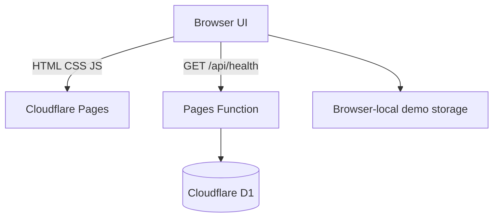

# JelHR System

A responsive multi-page HR workspace prototype for employee records, time tracking, onboarding, security visibility and organization settings. The existing black / cream / yellow visual direction is retained.

> **Release status:** interactive demo deployed to Cloudflare Pages. Demo records are browser-local and clearly marked. The D1 schema is provisioned and bound to Pages Functions; real HR data APIs and authentication are not enabled. Do not enter real employee, payroll, identity or health data.

## Current modules

| Module | Included | Current behavior |
|---|---|---|
| Dashboard | KPI overview, schedule and onboarding snapshot | Summary view |
| Employees | Directory, search, status filter, add employee, CSV export | Browser-local demo data |
| Time tracking | Start / pause timer | Browser-local timer entries |
| Onboarding | Eight-step checklist and progress | Browser-local task state |
| Security | Session/device overview | Demo-only session list; no real session revocation |
| Settings | Profile and workspace preferences | Browser-local preferences |
| API health | Pages Function and D1 connectivity | `GET /api/health` |

## Run locally

```bash
npm run dev
```

Open the local Pages development URL shown by Wrangler. The static prototype can also be previewed with `npm run preview`. Demo changes are stored in the current browser under `jelhr.demo.v1`.

## Cloudflare deployment

- Cloudflare Pages project: `jelhr-system`
- Production URL: https://jelhr-system.pages.dev
- Source: GitHub `DevJel/jelhr-system`, production branch `main`
- Pages Functions directory: `functions/`
- D1 binding: `DB` → `jelhr-system-db`
- SQL migrations: `migrations/`

GitHub pushes to `main` trigger production deployment. To deploy manually:

```bash
npm run db:migrate:remote
npm run deploy
```

## D1 data model

The initial migration creates organization-scoped tables for organizations, users, employees, time entries, onboarding tasks, sessions, audit logs and organization settings. Business-data tables carry an `organization_id` so future API handlers can enforce tenant boundaries.



## Security and production readiness

- No production credentials or secrets are committed.
- Demo browser data is not a secure database and is not shared across devices.
- The public health endpoint reveals only service and database availability.
- Employee and HR API routes are not enabled until authentication and tenant authorization are implemented.
- Do not deploy real employee data or enable payroll actions until login, invitation, password reset, MFA, RBAC, tenant-scoped queries, audit coverage, backup/restore and privacy controls pass review.

## Project structure

```
frontend/                 Static responsive UI
  css/app.css              Shared design system
  js/nav.js                Navigation and bootstrap
  js/app.js                Demo interactions and browser persistence
  _headers                 Security response headers
functions/api/health.js    Pages Function health check
migrations/0001_init.sql   Tenant-aware D1 schema
docs/architecture.md       Architecture and security boundaries
wrangler.toml              Pages build output and D1 binding
```
