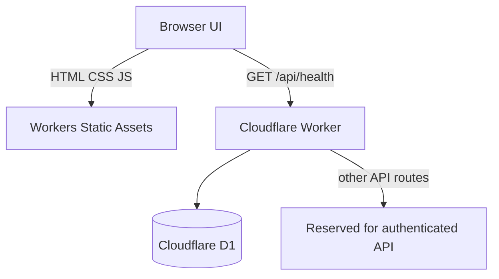

# JelHR System

A responsive, multi-page HR workspace foundation for employee records, time tracking, onboarding, security visibility and organization settings. The existing black / cream / yellow visual direction is retained.

> **Deployment mode:** public interactive demo. Demo records are browser-local and clearly marked. The Cloudflare Worker currently exposes a health endpoint only; authenticated multi-tenant data APIs are not yet enabled. Do not enter real employee, payroll, identity or health data into the demo.

## Current modules

| Module | Included | Current behavior |
|---|---|---|
| Dashboard | KPI overview, schedule and onboarding snapshot | Summary view |
| Employees | Directory, search, status filter, add employee, CSV export | Browser-local demo data |
| Time tracking | Start / pause timer | Browser-local timer entries |
| Onboarding | Eight-step checklist and progress | Browser-local task state |
| Security | Session/device overview | Demo-only session list; no real session revocation |
| Settings | Profile and workspace preferences | Browser-local preferences |
| API health | Worker and D1 connectivity | `GET /api/health` |

## Run locally

```bash
npm install
npm run dev
```

Open http://localhost:3000. The static prototype runs without credentials. Changes are stored in the current browser under `jelhr.demo.v1`.

## Cloudflare architecture

- Workers Static Assets serves `frontend/`.
- Worker script in `src/index.js` routes `/api/*`.
- D1 database binding: `DB`.
- SQL migrations are in `migrations/`.



### Deploy

```bash
npx wrangler d1 migrations apply jelhr-system-db --remote
npx wrangler deploy
```

The Wrangler configuration is already linked to the project D1 database. Deploy from the repository root using a Cloudflare account with access to the **Jelvan - Projects - Works** account.

## D1 data model

The initial migration creates organization-scoped tables for organizations, users, employees, time entries, onboarding tasks, sessions, audit logs and organization settings. Every business-data table carries an `organization_id` so future API handlers can enforce tenant boundaries.

## Security and production readiness

- No production credentials or secrets are committed.
- Demo browser data is not a secure database and is not shared across devices.
- The public health endpoint reveals service/database status only.
- Employee and HR API routes deliberately return 404 until authentication and tenant authorization are implemented.
- Do not deploy real employee data or enable payroll actions until login, invitation, password reset, MFA, RBAC, tenant-scoped queries, audit coverage, backup/restore and privacy controls pass review.

## Project structure

```
frontend/                 Static responsive UI
  css/app.css              Shared design system
  js/nav.js                Navigation and bootstrap
  js/app.js                Demo interactions and browser persistence
src/index.js               Cloudflare Worker entry point
migrations/0001_init.sql   Tenant-aware D1 schema
docs/architecture.md       Architecture and security boundaries
wrangler.toml              Worker, static assets and D1 binding
```
