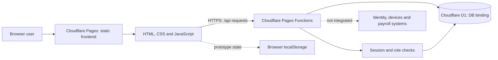
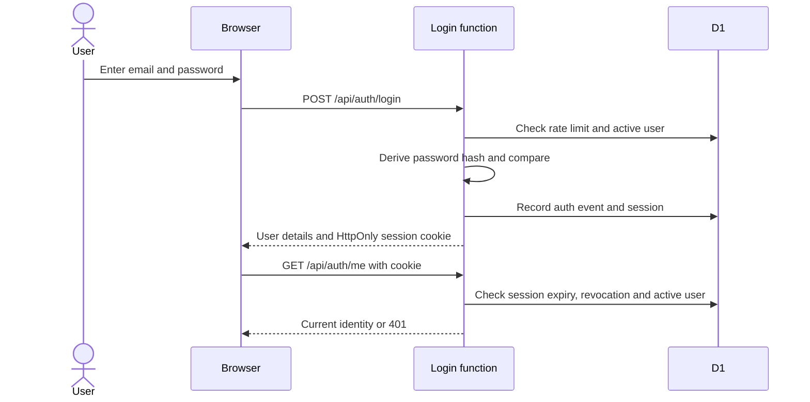
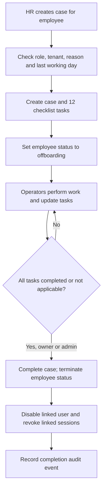
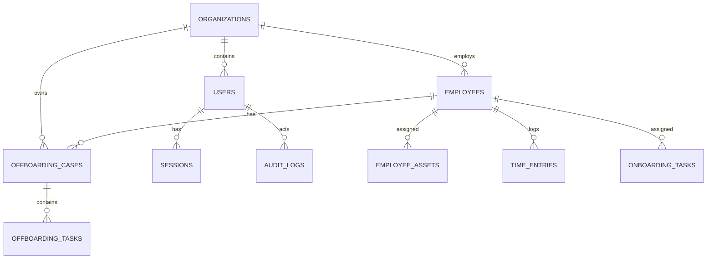

# JelHR System

JelHR is a Cloudflare Pages and D1 foundation for people operations. Its goal is to bring employee information, time, onboarding and offboarding into one workspace. The repository currently combines an authenticated API foundation with several **prototype or synthetic-data interfaces**; it is not a complete production HRIS.

> **Readiness:** Do not enter real employee, payroll, identity or health data until the security, privacy, provisioning and test items in [Production readiness](#production-readiness) are complete and independently verified. Repository code alone does not prove that a live deployment or database is configured correctly.

## Contents

- [Purpose and intended users](#purpose-and-intended-users)
- [Current feature inventory](#current-feature-inventory)
- [Architecture](#architecture)
- [Authentication and access](#authentication-and-access)
- [Offboarding workflow](#offboarding-workflow)
- [API reference](#api-reference)
- [Data model and migrations](#data-model-and-migrations)
- [Local development](#local-development)
- [Deployment and operations](#deployment-and-operations)
- [Testing and verification](#testing-and-verification)
- [Security, privacy and known gaps](#security-privacy-and-known-gaps)
- [Production readiness](#production-readiness)
- [Repository map](#repository-map)

## Purpose and intended users

The intended workspace serves administrators and HR operations teams coordinating the employee lifecycle, employees viewing a personal workspace, and auditors exploring a restricted demonstration. The current implementation supports only the capabilities identified below. In particular, final-pay fields track workflow status; they do **not** calculate payroll or send payments.

### Design and responsive scope

The updated sign-in and administrator dashboard draw on the supplied visual references: a soft neutral/yellow palette, rounded cards and a generated team illustration embedded in `frontend/css/bolek.css`. The sign-in uses email and password only; Apple and Google sign-in are not provided. The dashboard offers selectable panels on mobile, keeping the redesigned content within the viewport at the tested sizes. Other pages retain their existing layouts and can scroll. Very short sign-in viewports may scroll to keep the form usable.

## Current feature inventory

| Area | What exists | Important limitation |
|---|---|---|
| Sign-in | Email/password login, signed cookie, D1 session record, logout and one-time initial-owner bootstrap. | Runtime secrets and provisioning are required; security and production tests remain outstanding. No social sign-in or self-service registration. |
| Administrator dashboard | Responsive overview and links to existing modules; desktop cards and mobile panel selector. | Overview is not a live analytics dashboard; labels identify sample or prototype areas. |
| Employee workspace | Authenticated account name and email with sign-out. | No completed self-service employee-record or assigned-task APIs. |
| Demo workspace | Read-only presentation for the `auditor` role. | Must use a separately provisioned organization containing synthetic data only. |
| Employee directory | A tenant-scoped HR lookup API exists. | The existing directory page uses browser-local sample records rather than the lookup API; production CRUD is not implemented. |
| Time tracking | Prototype timer and local sample entries. | Not connected to the D1 `time_entries` table or a payroll system. |
| Onboarding | Prototype browser-local checklist. | Not connected to the D1 `onboarding_tasks` table. |
| Offboarding | D1-backed cases, generated tasks, status updates, final closure and audit events. | UI checklist interaction is incomplete; external IT, identity, payroll and asset integrations are not connected. |
| Security and settings | Existing demonstration surfaces. | They do not provide complete production session administration or persistent organization settings. |
| Hiring, apps, salary/payroll, calendar and reviews | No corresponding full module in this repository. | Require separately designed APIs, data models, authorization and UI. |

### Access roles

| Role | Current API or UI purpose |
|---|---|
| `owner`, `admin` | HR employee lookup and offboarding operations, including final case closure. |
| `hr_manager` | Employee lookup and offboarding list, creation and updates; cannot finalize a case. |
| `manager` | Individual offboarding case read and update endpoints allow this role, but the shared UI navigation currently restricts some HR pages. |
| `employee` | Redirected to the employee workspace by the shared navigation. |
| `auditor` | Directed to a read-only demo page; offboarding read endpoints allow this role within its organization. |

The offboarding PATCH handler also lists `it` and `finance` as allowed roles, but the current `users.role` database constraint does not permit these values. Treat that mismatch as an unresolved implementation gap, not as working access. Client-side navigation is a convenience; API-side authorization is the security boundary. Static page files can be served before the JavaScript gate runs, so do not place confidential data in HTML, CSS or JavaScript assets.

## Architecture



**How to read this diagram:** Pages serves the static UI; the browser calls Pages Functions for implemented API routes. Functions use the `DB` binding for authentication, HR lookup and offboarding. Some interfaces use browser-local synthetic state instead. The dashed external link is a future integration boundary, not a working connection. See [`docs/architecture.md`](docs/architecture.md) for additional notes.

### Components and responsibilities

- **`frontend/`** contains static HTML pages, shared CSS, the responsive design, and browser JavaScript. `frontend/js/nav.js` checks the current session for pages using shared navigation. The server must still enforce permissions.
- **`functions/api/`** contains Pages Functions for health, login, logout, bootstrap, current user, employee lookup and offboarding. `functions/_shared/auth.js` provides common user/role checks and an audit helper.
- **`migrations/`** defines the D1 schema. `wrangler.toml` specifies `frontend` as the Pages output directory and binds the database as `DB`.
- **Browser storage** is used by prototype features under `jelhr.demo.v1`. It is neither a secure employee system of record nor shared across users or devices. Avoid real data.
- **External providers** such as identity management, device management and payroll are not connected by the current offboarding workflow.

## Authentication and access



**How to read this diagram:** A successful login establishes both a signed cookie and a database session. Protected handlers verify the cookie and session, then check the active user and permitted role. The sequence shows the success path; invalid credentials, missing configuration, rate limits and revoked/expired sessions return errors.

### Current behavior

1. The login function normalizes the email, checks a hashed email/IP rate-limit key and looks up an active account. Passwords use a per-user salt and PBKDF2-HMAC-SHA-256 with 210,000 iterations.
2. On success, it signs an HS256 JWT and stores a hash of the token in a D1 session row. The cookie is `HttpOnly`, `Secure`, `SameSite=Strict`, scoped to `/`, and has an eight-hour max age.
3. `/api/auth/me` and the shared authorization helper verify the signature and expiry, find an unrevoked unexpired session, and check that the user is active. The current user's organization and role come from the database.
4. Logout clears the browser cookie and attempts to revoke the matching session. **Known defect:** the login hash omits Base64 padding while the logout hash retains it, so the lookup does not match and logout does not reliably revoke the server-side session. Fix and test this before real use.
5. Failed logins create an authentication event and update a rate-limit row; a locked key is rejected. This is an implementation description, not a guarantee that all abuse cases are covered.

**Known gaps:** Logout session revocation has the encoding mismatch described above. Password hash comparison is currently a regular string equality comparison, not a verified constant-time comparison. MFA, CSRF protection and Origin validation are not implemented. Login is keyed by email alone even though the schema's uniqueness constraint is organization-plus-email; a multi-tenant identity strategy and tests are needed. Review token validation, rate-limit lifecycle, session management, bootstrap concurrency and error handling before real use.

## Offboarding workflow



**How to read this diagram:** The API coordinates a checklist and tracks internal status; it does not itself disable an external identity account, collect equipment, calculate final pay or enforce local labor law. Those actions require authorized people and future integrations. Case creation, individual task updates and completion write audit events. Database operations in these workflows are currently separate statements, not a verified atomic transaction.

### Checklist and states

A new case creates 12 tasks covering: role documentation, project ownership, company account access, session and credential revocation, equipment collection, asset condition, final pay review, purchasing authority, exit interview, final-day notices, legal hold/retention and record closure. The task categories are `knowledge_transfer`, `it_access`, `assets`, `finance`, `people` and `compliance`.

Tasks accept `pending`, `in_progress`, `completed`, `blocked` or `not_applicable`; an optional evidence note can accompany an update. A case can only be finalized by an `owner` or `admin` after every task is `completed` or `not_applicable`. Finalization sets the case to `completed`, marks the employee `terminated`, disables the linked user if present and revokes that user's active D1 sessions. The API also accepts exit-interview and final-pay **status markers** and case notes. Follow the approved effective time for access removal, and apply appropriate retention and legal-hold policies.

The offboarding page can list/create cases and fetch a checklist. Its current prompt lists task titles and statuses but asks for a task ID without displaying IDs, so an operator cannot reliably update a task through that prompt alone. Complete and test the task-editing and finalization UI before relying on it.

## API reference

All routes are implemented as Cloudflare Pages Functions. JSON responses may include an `error` message. Except for health, bootstrap and login, routes use the session cookie as described above. Actual authorization is enforced by each handler; tenant-scoped queries use the authenticated user's organization. This table describes implemented code, not a complete public API contract.

| Route | Method | Current behavior and access |
|---|---|---|
| `/api/health` | GET | Runs a D1 `SELECT 1`; returns `200` with service/status/database/mode/timestamp, or `503` if D1 cannot be reached. It does not prove end-to-end readiness. |
| `/api/auth/bootstrap` | POST | One-time initial owner creation; requires bootstrap bearer token, configured secrets and explicit confirmation. Returns `409` if any owner/admin already exists. |
| `/api/auth/login` | POST | Accepts JSON `email` and `password`; returns user details and cookie on success. Invalid credentials return `401`; a locked rate-limit key returns `429`; missing required configuration returns `503`. |
| `/api/auth/me` | GET | Returns `authenticated` and current user details for a valid session, otherwise `401`. |
| `/api/auth/logout` | POST | Revokes a matching session when available and clears the cookie. |
| `/api/employees` | GET | Returns `{ employees: [...] }` for `owner`, `admin`, or `hr_manager`, scoped to their organization and non-terminated employment statuses. No employee create/update/delete endpoint is present. |
| `/api/offboarding` | GET | Returns `{ cases: [...] }` for `owner`, `admin`, `hr_manager`, or `auditor`, scoped to their organization. |
| `/api/offboarding` | POST | `owner`, `admin`, or `hr_manager` creates a case with `employeeId`, `reason`, `lastWorkingDay` (`YYYY-MM-DD`) and optional `notes`. A duplicate active case returns `409`. |
| `/api/offboarding/:id` | GET | Returns `{ case, tasks, assets }` for `owner`, `admin`, `hr_manager`, `manager`, or `auditor`, after a tenant-scoped case lookup. |
| `/api/offboarding/:id` | PATCH | Updates one task via `taskId`, `status`, optional `evidenceNote`; or case fields `exitInterviewStatus`, `finalPayStatus`, `notes`; or requests `action: "complete"`. Final closure is owner/admin only. See role-schema mismatch above. |

For PATCH, the task branch returns immediately when `taskId` is supplied. Case-field updates are executed before a requested finalization is checked, so a rejected finalization request can still have applied earlier case-field updates. Do not assume atomic updates. Use TLS, send `Content-Type: application/json` for JSON requests, and never place credentials in query strings or logs.

## Data model and migrations



**How to read this diagram:** An organization owns users and employees. A case belongs to an employee and has checklist tasks; sessions belong to users. Time entries and onboarding tables are present in the schema but their UI prototypes are not wired to those tables. The diagram omits some foreign keys and supporting tables for readability; the SQL migrations are authoritative.

| Migration | Purpose |
|---|---|
| `0001_init.sql` | Organizations, users, employees, time entries, onboarding tasks, sessions, audit logs and organization settings. |
| `0002_auth_offboarding.sql` | Authentication-related user fields, offboarding cases/tasks, employee assets, authentication rate limits and authentication events. |

Apply migrations in order to the intended environment. Verify the target database and back up data before remote changes. The `ALTER TABLE` statements in the second migration are not individually idempotent; do not manually rerun an applied migration. Existing D1 bindings or deployment status must be verified in the target Cloudflare account.

## Local development

### Prerequisites

- Node.js and npm. The repository does not currently pin Node, Wrangler or `serve` versions; the scripts invoke `npx wrangler@latest` or `npx serve`, which may fetch packages and can change over time.
- A Cloudflare-compatible Pages Functions environment with a local D1 binding for API development. Wrangler setup and a Cloudflare account may be needed for remote operations.
- A synthetic local dataset and locally configured development secrets for sign-in tests. Never commit `.dev.vars` or real credentials.

### Run

```bash
npm install
npm run db:migrate:local
npm run dev
```

`npm run dev` invokes Wrangler Pages development against `frontend/`; use the local URL printed by Wrangler. Local D1 and runtime secrets must be configured for the API paths being tested. `npm run preview` serves static frontend files with `serve` and is useful for layout inspection, but it does not by itself provide Pages Functions or a D1 backend.

### Runtime configuration and initial owner

Configure these as secrets in the intended Pages environment; do not place their values in source control:

| Secret | Purpose |
|---|---|
| `JELHR_JWT_SECRET` | Signing key for session tokens; the code requires at least 32 characters. Generate a high-entropy secret. |
| `JELHR_ADMIN_EMAIL` | Initial owner email used by the bootstrap function. |
| `JELHR_ADMIN_PASSWORD` | Initial owner password; bootstrap requires at least 14 characters. |
| `JELHR_BOOTSTRAP_TOKEN` | Separate high-entropy bearer token required for one-time owner provisioning. |

After reviewing the target environment and applying migrations, set `JELHR_BASE_URL` to the intended HTTPS deployment URL and use a protected shell with the one-time bootstrap endpoint:

```bash
curl -X POST "$JELHR_BASE_URL/api/auth/bootstrap" \
  -H "Authorization: Bearer $JELHR_BOOTSTRAP_TOKEN" \
  -H "Content-Type: application/json" \
  -d '{"confirmation":"PROVISION INITIAL ADMIN"}'
```

The handler rejects provisioning if an owner/admin already exists. Remove the bootstrap token and initial admin password from runtime configuration after successful provisioning, using the approved operational process. Do not paste tokens or passwords into tickets, chat or repository files. Review bootstrap authorization and concurrency before production.

## Deployment and operations

The checked-in configuration targets Cloudflare Pages project `jelhr-system`, serves `frontend/`, uses repository-level `functions/`, and binds D1 as `DB` in `wrangler.toml`. The README previously identified `main` as the production deployment branch and `https://jelhr-system.pages.dev` as the project URL; verify current account, environment and Git integration before acting. A push to a review branch is not a production deployment.

1. Review the change and run tests in a safe environment.
2. Verify the intended Pages project, D1 binding, environment secrets and migration state.
3. Apply approved migrations with a backup and rollback plan. The package script `npm run db:migrate:remote` targets the configured remote D1 database; do not run it casually.
4. Deploy only through the project's approved deployment process. The repository also defines `npm run deploy`, which invokes Wrangler Pages directly; its presence is not an authorization to deploy.
5. Check `/api/health`, sign-in, role/tenant boundaries and relevant workflows in the target environment. Health alone is not a release sign-off.
6. Monitor errors and audit events without logging secrets or unnecessary personal information; follow incident response and retention policy.

Backups, restore drills, data retention, incident response, legal compliance and production monitoring must be established and tested separately. Never assume a Secrets Store from a different Cloudflare account is automatically connected to this Pages project.

## Testing and verification

```bash
npm test
```

This runs `scripts/smoke-test.mjs`, which checks expected files and selected static markers. It does **not** exercise authentication, D1 migrations, authorization, tenant isolation, offboarding completion or production deployment.

The redesign was also checked locally at 1440×900, 390×844 and 320×568 for page overflow and mobile dashboard panel switching. Browser checks used mocked identity/login responses and did not verify a live backend. Repeat checks across supported browsers, zoom levels, orientations, keyboard/screen-reader use, short viewports, error states and actual environments before release.

Required additional automated/integration coverage includes login/logout and revocation; expired and disabled-user sessions; role and tenant isolation; malformed/oversized inputs; CSRF/Origin controls; bootstrap; duplicate offboarding cases; task states; authorization of final closure; failure/partial-write behavior; and migration/backup restore. Use synthetic records only.

## Security, privacy and known gaps

- **Not production-ready:** runtime provisioning, MFA for privileged users, CSRF/Origin protections, authorization review, operational controls and security testing remain incomplete.
- **Prototype boundaries:** browser-local employee, time, onboarding and settings data are not a protected multi-user system of record. Never enter actual HR information in these surfaces.
- **Tenant and role review:** endpoints derive organization from the authenticated user, but tenant isolation and object-level access need automated tests and independent review. The role-schema mismatch and email lookup ambiguity described above need resolution.
- **Logout defect:** Fix and verify the token-hash encoding mismatch before relying on logout to revoke a session.
- **Sensitive workflow:** offboarding contains sensitive information and can disable accounts. Its current multi-statement writes and audit writes need transaction/failure review, and finalization should be tested before operational use.
- **Privacy:** define employee access rights, privacy notices, retention, legal holds, deletion/export processes and access logging for the relevant jurisdictions.
- **Demo isolation:** provision an auditor account in a separate synthetic-only organization; never attach a demo account to a production tenant.

## Production readiness

- [ ] Configure environment-specific secrets, D1 bindings and controlled deployment access; provision and verify the initial owner, then remove bootstrap credentials.
- [ ] Provision a separate synthetic demo organization and appropriate accounts; map employee users to the correct employee records.
- [ ] Implement and test CSRF protection, Origin validation, privileged MFA and secure recovery.
- [ ] Fix and test logout session revocation; review password comparison, identity uniqueness, JWT/session validation, rate limiting, bootstrap concurrency and audit handling.
- [ ] Implement API-backed employee CRUD and self-only employee reads; resolve role/schema and UI authorization differences.
- [ ] Complete time, onboarding, security, settings and offboarding UI/API flows; add requested HR modules only with approved requirements and controls.
- [ ] Add transactional protections, idempotency and failure recovery where needed; connect external systems only after authorization and integration design.
- [ ] Run automated authentication, role, tenant-isolation, workflow and session-revocation tests; complete accessibility and responsive testing.
- [ ] Approve privacy, retention, legal-hold, backup/restore, incident-response and security reviews before real data.

## Repository map

```text
frontend/                  Static Pages UI and browser scripts
  login.html               Email/password sign-in
  index.html               Administrator dashboard
  employee.html            Employee landing page
  demo.html                Auditor demo presentation
  offboarding.html         Offboarding case UI
  css/app.css              Existing shared styles
  css/bolek.css            Redesigned login/dashboard and embedded generated image
  js/nav.js                Session-aware shared navigation
  js/app.js                Browser-local prototype interactions
  js/login.js              Sign-in request handler
  js/dashboard.js          Mobile panel and page selector
functions/_shared/         Shared session, role and audit helpers
functions/api/             Pages Function endpoints
migrations/                D1 schema migrations
scripts/smoke-test.mjs     Static smoke checks
wrangler.toml              Pages and D1 binding configuration
docs/architecture.md       Supporting architecture notes
```
