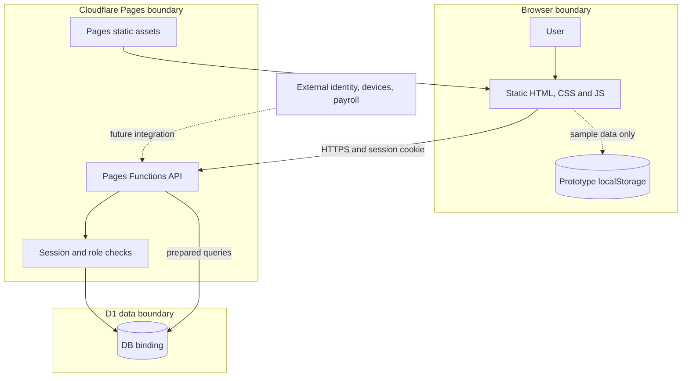
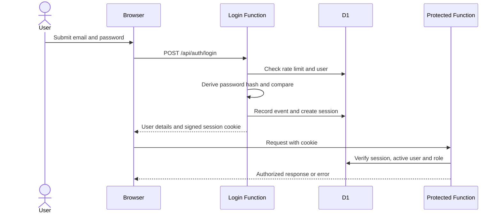
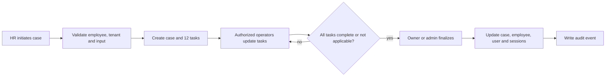
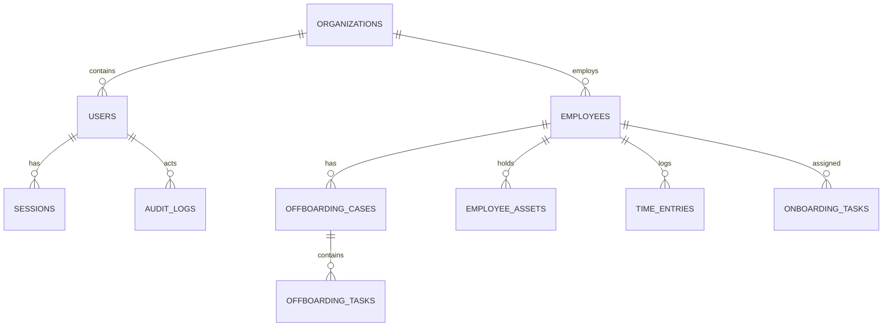

# JelHR architecture

This document explains the repository architecture, trust boundaries and operational flows as implemented. For installation and API routes see the [root README](../README.md); for controls and known security gaps see [security.md](security.md). The application is not yet ready for real employee or payroll data.

## Purpose and scope

JelHR aims to support employee lifecycle operations through a static, responsive HR interface backed by Cloudflare Pages Functions and D1. The currently implemented server workflows are authentication, employee lookup, health and offboarding. Several UI features remain browser-local prototypes, and hiring, payroll, apps, calendar and reviews are not complete modules.

## System context and trust boundaries

**Explanation:** Pages delivers the user interface, and the browser calls same-origin Functions. Protected handlers validate the session and look up the user's role and organization in D1. Static HTML and JavaScript are not themselves private merely because client-side navigation redirects unauthenticated users. The browser-local prototype is outside D1 and must contain synthetic data only. Dashed external integrations are not implemented.

## Components and responsibilities

| Component | Responsibility | Source |
|---|---|---|
| Static UI | Sign-in, dashboard and multi-page workflows. Browser navigation helps select the right UI but is not the security boundary. | `frontend/*.html`, `frontend/css/` |
| Client code | Login requests, session-aware navigation, responsive panel selection and prototype behavior. | `frontend/js/` |
| Pages Functions | Route requests for authentication, health, HR lookup and offboarding. | `functions/api/` |
| Shared authorization | Verify signed session payload, check active session and user, enforce handler role list; write audit events. | `functions/_shared/auth.js` |
| D1 | Store organization-scoped employee and workflow records, user credentials, session state and audit/auth events. | `migrations/`, `wrangler.toml` |
| Worker stub | A separate Worker module with an `ASSETS` expectation and a basic health handler. | `src/index.js` |

The Pages configuration does not declare the `src/index.js` Worker entry point or an `ASSETS` binding. Pages Functions and a Workers Builds deployment are different execution paths: choose and verify a deployment architecture rather than assuming the same build command supports both. For the requested Cloudflare build, account access and build logs must be checked before diagnosing the failure.

## Sign-in and authenticated requests

**Explanation:** The diagram shows the intended successful request path. The signed cookie is not sufficient by itself: the code also checks the stored D1 session and active user. The current logout implementation has a token-hash encoding mismatch and does not reliably revoke the server-side session. MFA, CSRF/Origin controls and further session/authorization testing remain necessary.

## Offboarding flow and ownership

**Explanation:** The application records a checklist and internal state. It does not itself remove external identity-provider access, process payments or collect devices. Such actions need authorized operators or future integrations. Current database writes are separate statements, so a failure may leave partial changes; transactional behavior must be reviewed and tested. The existing checklist prompt is incomplete because it asks for an ID it does not display.

## Data model

**Explanation:** Organization ownership scopes users and employees; cases have tasks, and sessions belong to users. Several tables are only a foundation: time and onboarding prototypes do not write to their D1 tables. This is a simplified relationship view; the migrations define the actual foreign keys and constraints.

`0001_init.sql` creates the initial organization, user, employee, time, onboarding, session, audit and settings tables. `0002_auth_offboarding.sql` adds authentication fields, offboarding cases/tasks, assets and authentication event/rate-limit tables. Apply through the migration process in order; verify the target and backup/restore plan before any remote change.

## Deployment and environment separation

- The repository config targets Pages static output `frontend/`, Pages Functions in `functions/`, and a `DB` D1 binding. Verify the target project's actual bindings and deployment pipeline independently.
- Preview and production should use separate bindings and secrets, synthetic preview data, controlled release approvals and CI deployment. The repository does not by itself establish those controls.
- A static server such as `npm run preview` does not emulate Pages Functions or D1; use Wrangler Pages development and local bindings for integration tests.
- The health endpoint checks a simple database query. A healthy result does not establish that auth, tenant isolation, migrations, offboarding or other features are ready.
- Build logs, deployment settings, secrets and D1 data are account-specific. Do not make destructive changes, migrate a remote database or deploy to production without review and explicit approval.

## Architectural risks and future work

1. Fix logout revocation, CSRF/Origin enforcement, privileged MFA and bootstrap/session controls.
2. Resolve email lookup across organizations and the mismatch between allowed handler roles and schema roles. Enforce and test tenant/object-level authorization.
3. Implement transaction/idempotency and recovery for case creation, updates, closure and audit records.
4. Replace local prototype data with approved, server-authorized APIs and role-specific UI as requirements are agreed.
5. Pin tooling, establish integration/acceptance tests, access controls, observability, backups and restore drills.
6. Define data classification, retention, legal hold, export and deletion workflows before real data.
