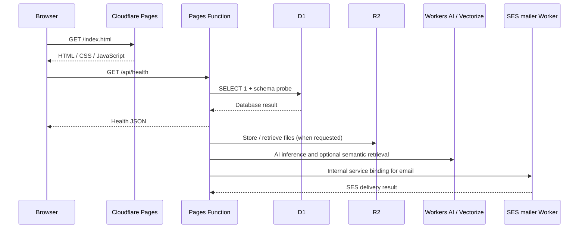
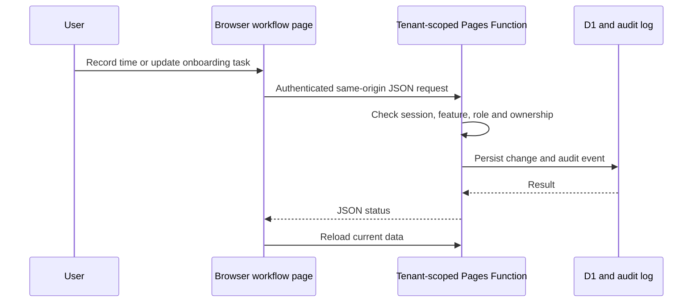
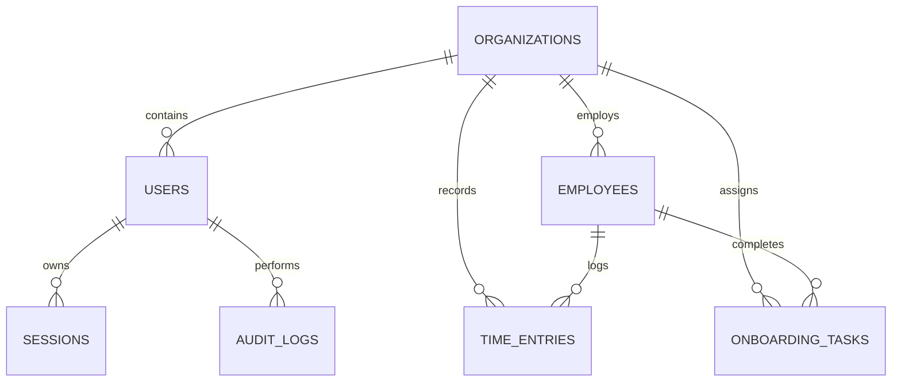

# JelHR System architecture

## Deployment boundary

Cloudflare Pages in the Jelvan - Business - Operava account serves the static application from `frontend/`. Pages Functions in the repository-level `functions/` directory handle API routes. The production bindings are `DB` (D1), `FILES` (R2), `AI` (Workers AI), `VECTORIZE` (Vectorize) and `MAILER` (internal SES mailer Worker). The Wrangler file is the source of truth for resource bindings. Preview deployments remain disabled until separate preview resources are provisioned.

## Request flow

## Time and onboarding UI data flow

Time and onboarding are stored in JelHR; there is no live cross-tab subscription or external payroll/attendance synchronization.

## Tenant model

Every future data query must derive `organization_id` from a verified session, never from an untrusted browser-supplied tenant header or request body. All write actions must create audit events in the same logical transaction/batch.

## Authentication and release boundary

The v0.4 backend implements password authentication, session revocation, role checks, MFA/passkey endpoints, OIDC SSO, invitation APIs and platform administration APIs. Production session signing and encryption secrets are configured as encrypted Pages secrets. The platform super-admin email/password secrets are still missing, so platform administration is not yet initialized.

The browser UI remains v0.3. Do not enable MFA/passkey policy or onboard real employees until the corresponding v0.4 login, security and invitation screens are built and tested. Keep the deployment on synthetic data until the go-live checklist in [DEPLOYMENT.md](../DEPLOYMENT.md) is complete.

## Privacy

Use synthetic demo data only. Production rollout requires a privacy notice, retention schedule, employee data access policy, export/deletion workflows, least-privilege roles, audit retention, incident response and verified backups.
