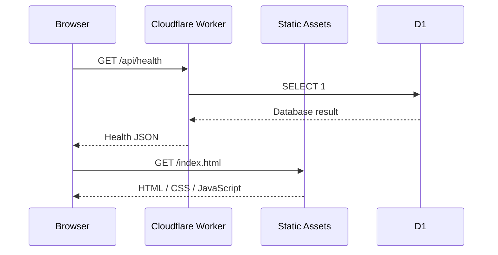
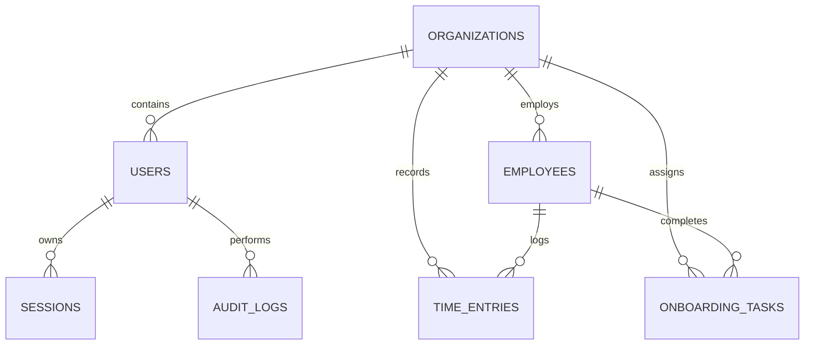

# JelHR System architecture

## Deployment boundary

The first Cloudflare release serves the current static multi-page experience from Workers Static Assets. The Worker runs first only for `/api/*`; all other requests are served as static assets.

## Request flow

## Tenant model

Every future data query must derive `organization_id` from a verified session, never from an untrusted browser-supplied tenant header or request body. All write actions must create audit events in the same logical transaction/batch.

## Authentication plan before real HR data

1. Invite-only organization owner bootstrap.
2. Password hashing using a modern password KDF and constant-time verification.
3. Opaque, random session tokens stored only as hashes; secure, HttpOnly, SameSite cookies.
4. Session rotation, expiry, logout and revocation.
5. Role-based access control with server-side permission checks.
6. MFA and recovery controls before production onboarding.
7. Rate limits and abuse monitoring for authentication routes.

No authentication endpoints are enabled in the current demo deployment.

## Privacy

Use synthetic demo data only. Production rollout requires a privacy notice, retention schedule, employee data access policy, export/deletion workflows, least-privilege roles, audit retention, incident response and verified backups.
