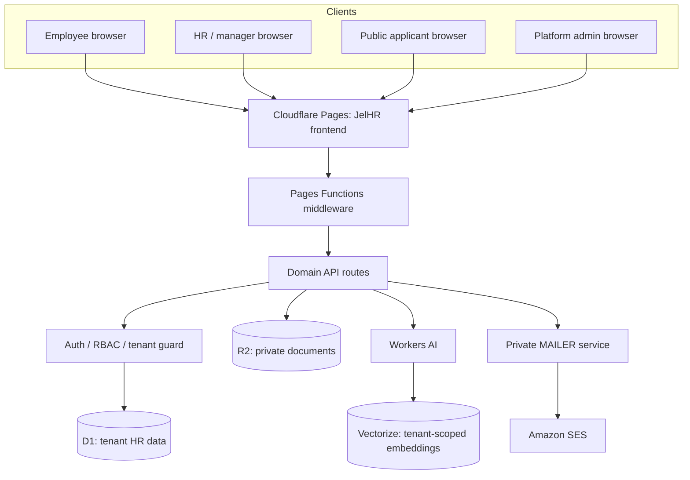

# JelHR production architecture and release plan

## Target architecture

JelHR is a multi-tenant HRIS. Browser pages are served from Cloudflare Pages; Pages Functions enforce authentication, authorization, validation and tenant boundaries. D1 stores structured HR records; R2 stores private documents; Workers AI supports approved assistive tasks; Vectorize is optional for organization-scoped retrieval; a private mailer Worker sends mail through SES.

## Target trust boundaries

1. Browser is untrusted. Never trust tenant IDs, role names, feature flags, prices, file paths or permissions supplied by the browser.
2. Pages Functions are the policy enforcement point. Every route validates session, role, organization ownership, request shape and state transition.
3. D1 is tenant-scoped. Every query for tenant data includes a server-derived organization ID.
4. R2 is private. No public bucket access for employee documents, applicant résumés, identity records or signed documents. Use short-lived, authorized download responses.
5. AI receives the minimum necessary data. Separate organizations in retrieval, log only usage metadata and require human approval for consequential HR actions.
6. Mailer is private. Only the internal service binding can invoke it; validate sender/recipient policy and never accept arbitrary relay instructions from browser input.
7. Secrets are encrypted Cloudflare secrets. Rotate with a documented overlap period and audit access.

## Release stages

### Stage 0 — Source and account verification
- Confirm repository and branch protection.
- Confirm production Pages project `jelhr-system` belongs to **Jelvan - Business - Operava**.
- Confirm custom domain and production environment.
- Verify exact Pages Functions bindings and secrets without printing secret values.
- Verify D1 ID, R2 bucket, Vectorize index and MAILER service binding against `wrangler.toml`.
- Keep the Projects - Works account untouched.
- Keep preview deployments disabled until isolated preview resources exist.

### Stage 1 — Database and backend readiness
- Apply migrations in order to a staging database first.
- Validate schema/indexes and foreign keys.
- Run full unit/integration suite and endpoint smoke tests.
- Test tenant isolation using two synthetic organizations.
- Test RBAC matrix for owner, admin, HR manager, manager, employee and auditor.
- Verify audit entries for sensitive state changes.
- Verify rate limits and challenge expiration/replay controls.
- Verify R2 private upload/download, MIME/size validation and malware scanning/operational review process.
- Confirm no production OTP/dev codes or sensitive values in responses/logs.

### Stage 2 — Identity and communication
- Configure JWT signing and encryption secrets; document key rotation and recovery.
- Configure SES sender/domain verification, DKIM/SPF/DMARC and delivery monitoring.
- Verify real OTP/invitation delivery, bounce handling and rate limits.
- Configure Turnstile site and secret keys for exact production hostnames and actions.
- Configure passkey RP ID/origins and test iOS Safari, Android Chrome and desktop Chrome/Safari/Firefox.
- Configure TOTP enrollment and recovery.
- Test OIDC against a dedicated test identity provider before enabling enforcement.
- Verify platform super-admin bootstrap through a controlled, one-time procedure.

### Stage 3 — Privacy, operations and resilience
- Publish employee/applicant privacy notices and lawful purpose/retention schedule.
- Define data subject access, correction, export and deletion workflows.
- Define retention and secure deletion for résumés, identity docs, employee records, audit logs and AI conversations.
- Establish backup schedule and perform restore test.
- Define incident response, security contact, breach escalation and access revocation.
- Set alerts for login failures, OTP abuse, unusual admin changes, storage errors, mail delivery failures and AI quota exhaustion.
- Verify accessibility, keyboard-only navigation, screen readers and reduced-motion behavior.
- Perform 320px mobile, tablet and desktop layout checks, including auth flows.

### Stage 4 — Controlled go-live
- Use synthetic test tenants and designated test accounts.
- Pilot with a small authorized HR group; no bulk employee import at first.
- Confirm HR owner approves role assignments, templates, onboarding/offboarding workflows and privacy text.
- Enable production authentication only after all Stage 1–3 evidence is recorded.
- Import real employee/applicant data in a logged, approved migration with rollback/export.
- Monitor error rate, login failures, D1 latency, storage, SES delivery and audit logs.
- Keep a tested rollback commit and documented migration compatibility.

## Production secret inventory (names only)

Required or feature-dependent; set as encrypted secrets in the correct production Pages project:
- `JELHR_JWT_SECRET` (at least 32 characters; strong random secret)
- `JELHR_ENCRYPTION_KEY` (cryptographically strong key in the format expected by crypto helpers)
- `JELHR_SUPERADMIN_EMAIL`
- `JELHR_SUPERADMIN_PASSWORD` (strong, one-time bootstrap; never commit)
- `JELHR_SUPERADMIN_TOTP_SECRET` (only if bootstrap policy uses it)
- `TURNSTILE_SECRET_KEY` (server-side)
- `AI_API_KEY` / `ANTHROPIC_API_KEY` only if a configured provider needs them
- OIDC client secrets, encrypted before persistence where supported
- Mailer Worker secrets (SES SMTP credentials) stored only in the mailer service's secret store

Public/non-secret configuration:
- `TURNSTILE_SITE_KEY`
- `JELHR_WEBAUTHN_RP_ID`
- `JELHR_WEBAUTHN_ORIGINS`
- `AI_API_BASE` where it is not credential-bearing
- Non-secret provider/model identifiers

The actual runtime binding inventory is defined by `wrangler.toml` and [DEPLOYMENT.md](../DEPLOYMENT.md). Confirm each binding in the target Cloudflare account before release. Never echo secret values during checks.

## Rollback and migration policy

- Code rollback: redeploy the last known-good Pages build/commit after confirming schema compatibility.
- Database rollback: do not assume D1 migrations are reversible. Prefer forward-fix migrations; take and verify backups before risky changes.
- Feature rollback: disable the feature flag or enforcement policy before removing code.
- Identity rollback: preserve old signing keys during a planned rotation window; revoke compromised keys immediately with coordinated verifier updates.
- Never delete user, employee, applicant or audit records as a deployment rollback shortcut.

## Release evidence checklist

A release is not complete until each item has an owner, timestamp and evidence:
- [ ] Correct production Cloudflare account and Pages project verified.
- [ ] GitHub PR merged and CI green for exact merge commit.
- [ ] Cloudflare production deployment succeeded for exact merge commit.
- [ ] D1 migrations applied and verified.
- [ ] All required bindings and secrets present (values never exposed).
- [ ] Health and smoke tests pass.
- [ ] Auth matrix and cross-tenant tests pass.
- [ ] Real SES delivery and Turnstile Siteverify pass.
- [ ] Passkey/TOTP/OIDC tests pass where enabled.
- [ ] Privacy, retention, backup restore and incident response approved.
- [ ] Browser/device/accessibility checks pass.
- [ ] Rollback path tested and synthetic-data pilot signed off.
