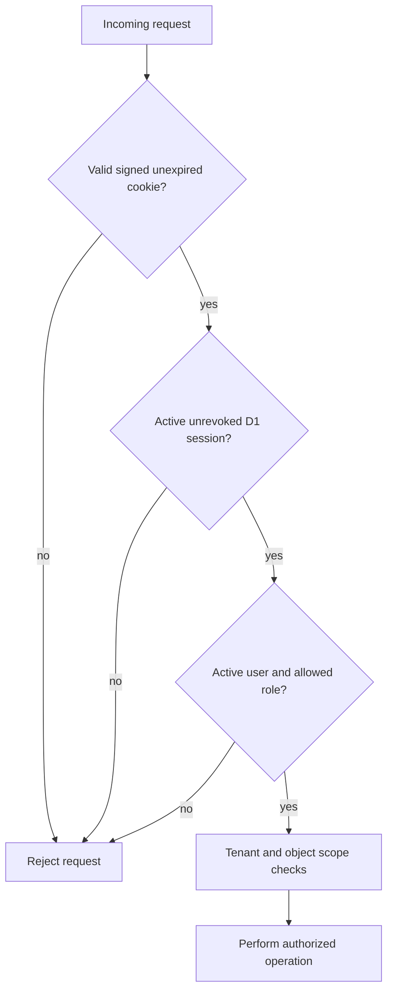

# Security and privacy documentation

## Status and scope

JelHR is a foundation, **not a production-ready HRIS**. This document records controls visible in the repository, known defects, the security model and work required before handling real employee or payroll data. It is not an ISO certification, penetration test, guarantee of compliance, or evidence that any Cloudflare account is configured securely. Review actual deployed configuration separately.

## Assets, actors and trust boundaries

| Asset | Examples | Why it matters |
|---|---|---|
| Credentials and secrets | Password hashes/salts, JWT signing secret, initial-owner and bootstrap credentials | Compromise can enable account takeover or unauthorized session issuance. |
| Employee data | Identity/contact details, employment status, offboarding reason and notes | Sensitive personal information requiring least privilege, retention limits and legal controls. |
| Sessions and audit data | Session token hashes, authentication events, HR action audit logs | Required for access control, revocation and investigation; must be protected and retained appropriately. |
| Operational resources | Cloudflare project, D1 database, GitHub repository and CI credentials | Incorrect access or deployment can affect all tenants and availability. |
| Prototype state | Browser-local example employees, tasks and time entries | Stored on the user's browser; it must not be used for real HR records. |

Actors include owner/admin, HR manager, manager, employee and auditor. Browser inputs and cookies are untrusted. Pages assets, Functions, D1, source control and external providers are distinct boundaries. The demo auditor must be assigned to a separate synthetic-only organization.

## Controls visible in code

| Area | Observed behavior | Limitations or verification needed |
|---|---|---|
| Password handling | PBKDF2-HMAC-SHA-256 with a per-user salt and 210,000 iterations during bootstrap/login. | Login compares derived strings with ordinary equality; use and verify constant-time comparison. Validate recovery and password lifecycle. |
| Session cookie | Signed HS256 JWT; `HttpOnly`, `Secure`, `SameSite=Strict`, path `/`, eight-hour max age. | Validate full JWT/session behavior, expiry, rotation and protections across environments. |
| Server-side session | The API checks signature/expiry, an unrevoked D1 session and active user. | The current logout hash encoding mismatch prevents reliable server-side revocation; see below. |
| Authorization | Protected HR handlers use role lists and organization-scoped queries based on the authenticated user. | Audit object-level permissions and cross-tenant references; test all roles. `it` and `finance` are accepted by a PATCH handler but excluded by the schema. |
| SQL | Current query code uses D1 prepared statements with bound values. | Review all new queries and migrations; prepared statements do not replace authorization or schema validation. |
| Login throttling | A hashed email/IP key is checked and auth events are written. | Evaluate lockout window/reset semantics, abuse resistance, enumeration and operational alerting. |
| Offboarding auditing | Case creation, task updates and finalization write audit events. | Writes are not verified atomic with state changes; case-field-only updates are not covered by those listed audit events. |
| Browser response headers | `frontend/_headers` defines `nosniff`, referrer policy, `X-Frame-Options`, permissions policy and HSTS. | Verify actual deployed headers and domains. A Content Security Policy is not defined there. HSTS does not substitute for a broader security review. |
| Bootstrap | Requires a bearer token, confirmation text, runtime secrets and absence of an existing owner/admin. | Review concurrency, access control, secret cleanup and failure recovery. |

## Critical known defect: logout revocation

Login stores the session token hash as unpadded Base64URL. Logout converts `+` and `/` but retains Base64 padding, so its database lookup does not match the stored value. The browser cookie is cleared, but the server-side session may remain valid until expiry or another revocation mechanism acts. Treat this as a release blocker: correct encoding consistently and add a regression test that logs in, logs out and proves the original cookie is rejected. Documentation alone does not fix the defect.

## Authentication and authorization expectations

**Purpose:** This diagram illustrates the checks expected before a protected operation. The actual checks vary by handler and require tests; it should not be read as proof that every object-level authorization or threat is addressed. Static frontend redirects do not secure API data.

## Threats and required mitigations

| Risk | Current exposure or gap | Required work before production |
|---|---|---|
| Account takeover | No privileged MFA; password comparison and recovery need review. | Add strong MFA, account lifecycle/recovery controls, secure comparisons, rate-limit tests and alerting. |
| Cross-site requests | State-changing cookie-authenticated routes lack documented CSRF/Origin validation. | Implement and test CSRF defenses and explicit Origin policy for all state-changing endpoints. Do not rely on `SameSite` alone. |
| Session replay | Logout revocation defect; broader session lifecycle not fully tested. | Fix hash mismatch; test revoked, expired, disabled-user and stolen-cookie scenarios; review rotation and incident response. |
| Cross-tenant access | Tenant-scoped handlers exist, but edge cases and foreign-key relationships are not fully verified. | Add object-level authorization and isolation tests, including IDs from other tenants and mismatched linked records. |
| Ambiguous identity | Users are unique by organization/email while login selects by email alone. | Define identity/tenant discovery and enforce a consistent uniqueness/lookup policy. |
| Inconsistent writes | Offboarding and audit operations use separate statements. | Introduce appropriate transactional or recoverable workflows, idempotency and failure-injection tests. |
| Data exposure | HR details can be sensitive; browser prototypes persist locally. | Use synthetic data only until classification, access controls, retention, privacy notice, access logging and deletion/export processes are approved. |
| Supply chain | Runtime tool commands use unpinned `npx` packages; no lockfile is present. | Pin and review versions, verify dependencies, maintain patching and a reproducible CI pipeline. |
| Misconfiguration | Pages, Workers and D1 bindings differ; secrets or environments may be missing or incorrect. | Verify account/project, separate environments, minimize privileges, restrict previews, secure bindings and fail closed. |
| Build/deployment failure | A failed build may leave an older version running or no usable deployment; the linked build has not been inspected. | Inspect actual logs and configuration before making a change; deploy only reviewed changes through an approved pipeline. |

## Secrets and configuration

- Configure `JELHR_JWT_SECRET`, `JELHR_ADMIN_EMAIL`, `JELHR_ADMIN_PASSWORD` and `JELHR_BOOTSTRAP_TOKEN` only through the intended environment's approved secret mechanism. Never commit, log or paste their values into chat.
- Use separate high-entropy values and separate development/preview/production environments. Provision the first owner only in the intended target and remove bootstrap-only credentials afterward.
- `.gitignore` does not explicitly include `.dev.vars`; take care not to stage local secret files. Restrict Cloudflare and GitHub access and scope CI tokens to the minimum needed.
- A different account's Secrets Store or D1 binding is not automatically available to this application. Confirm the actual binding and permissions; do not copy secrets across accounts without authorization.

## Security validation before release

1. Review the code, threat model, privacy and operational requirements with the responsible owners.
2. Add automated tests for authentication, password validation, login failures and throttling; revoke and reject a previously valid session after logout.
3. Test every route for missing/expired/revoked sessions, disabled users, allowed and denied roles, cross-tenant IDs, malformed or oversized input, and CSRF/Origin behavior.
4. Test bootstrap concurrency and one-time behavior, offboarding duplicates and failure recovery, closure approval, partial failures and audit events.
5. Verify secure headers, TLS, least-privilege identities and deployment configuration in each environment. Review logs for unnecessary personal data and secrets.
6. Establish and exercise backups, restore procedures, incident response, monitoring, privacy/retention rules, legal holds and access reviews.
7. Perform an independent security review and applicable legal/privacy review; record findings and approvals. Do not claim production readiness or certification until requirements are verified.

## Related documents

[Root README](../README.md) · [Architecture](architecture.md) · [Technology stack](stack.md)
