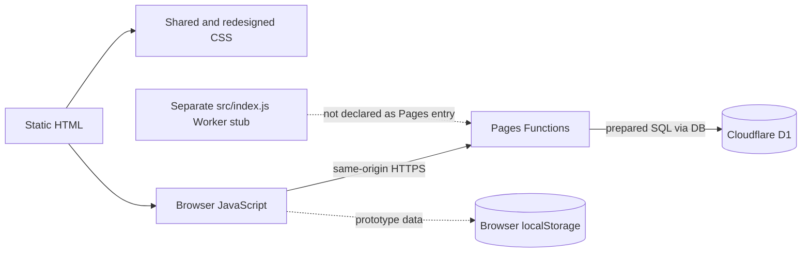

# Technology stack and dependency inventory

This document describes the repository's current stack, its purpose and its known gaps. It is an inventory, not proof that a particular Cloudflare account or deployment uses every component below.

## Application stack

| Layer | Technology | Purpose and location | Current limitation |
|---|---|---|---|
| User interface | HTML, CSS and browser JavaScript | Static multi-page UI under `frontend/`; `frontend/css/app.css` is the existing shared stylesheet and `frontend/css/bolek.css` is the redesigned sign-in/dashboard. | Several screens use prototype data; the redesign covers only sign-in and dashboard. |
| UI state | Browser `localStorage` and in-memory state | `frontend/js/app.js` uses `jelhr.demo.v1` for prototype interactions; the redesigned dashboard also has client-side panel selection. | Not a secure or synchronized HR system of record. Do not put real HR data into prototype screens. |
| Application API | Cloudflare Pages Functions | `functions/api/` implements auth, health, employee lookup and offboarding HTTP handlers; `functions/_shared/auth.js` contains shared authorization and audit helpers. | There are no full hiring, payroll, apps, calendar, reviews, time-entry or onboarding APIs. |
| Database | Cloudflare D1 (SQLite-compatible) | D1 binding `DB`; schema in `migrations/`; parameterized statements in current handlers. | Tables do not imply that every UI is connected or that tenant isolation and transactional behavior are fully tested. |
| Identity/session | Web Crypto, PBKDF2-HMAC-SHA-256, HS256 JWT and D1 session records | The login function derives password hashes, signs a session cookie and records a session. | MFA and CSRF/Origin controls are absent; a logout token-hash encoding defect and other readiness gaps remain. See [security.md](security.md). |
| Hosting | Cloudflare Pages with Pages Functions | `wrangler.toml` specifies `pages_build_output_dir = "./frontend"` and D1 binding `DB`. | Confirm the actual project, account, environment, secrets and deployment pipeline before release. |
| Alternative Worker source | Cloudflare Worker module | `src/index.js` contains a separate basic Worker handler expecting an `ASSETS` binding and exposes a health route. | The checked-in Wrangler file is configured for Pages and does not declare this Worker entry point or an `ASSETS` binding. Do not assume it is deployed or a replacement for Pages Functions. |
| Build/dev tooling | Node.js, npm, Wrangler and `serve` | Commands are in `package.json`; `npm run dev` uses Wrangler Pages development and `npm run preview` serves static files. | Node is not pinned. The scripts use `npx wrangler@latest` and `npx serve`; versions are not reproducible until pinned and reviewed. Static preview does not run the API. |
| Source control | Git and GitHub | Source repository, branches and pull-request review. | A review branch is not automatically a production release. Check the actual Cloudflare build's configured repository and branch. |
| Tests | Node.js `assert` and filesystem APIs | `npm test` runs `scripts/smoke-test.mjs` static checks. | No repository integration suite currently verifies authentication, tenant isolation or offboarding. |

There are no declared runtime dependencies or `devDependencies` in the checked-in `package.json`. There is no checked-in lockfile or explicit Node version file in this repository snapshot. The `compatibility_date` in `wrangler.toml` is `2026-11-03`; it is not the Node version or a security certification. Tool downloads via `npx` can change over time and should be pinned after review.

## Request and runtime mapping

**Purpose:** This diagram identifies which runtime handles each part of the project. The dashed browser-storage connection denotes local sample state; the separate Worker stub is not automatically the Pages API. The diagram does not assert that the Worker stub is deployed.

## Files and version controls to review

- `package.json`: package scripts and dependency declarations.
- `wrangler.toml`: Pages output directory, compatibility date and D1 binding configuration.
- `migrations/0001_init.sql` and `migrations/0002_auth_offboarding.sql`: schema history and ordering.
- `frontend/_headers`: configured browser security headers. Confirm deployed headers separately.
- `functions/`: actual server-side authorization and API behavior.
- `scripts/smoke-test.mjs`: static-only smoke checks.

The repository's `.gitignore` ignores `.env` files but does **not** explicitly ignore `.dev.vars`; keep local Wrangler secrets outside version control and verify `git status` before staging. Never add credentials or personal data to the repository.

## Related documents

- [Root README](../README.md): setup, feature inventory, routes and release checklist.
- [Architecture](architecture.md): components, request flows, data model and operational boundaries.
- [Security](security.md): current controls, known defects, risk treatment and verification requirements.
